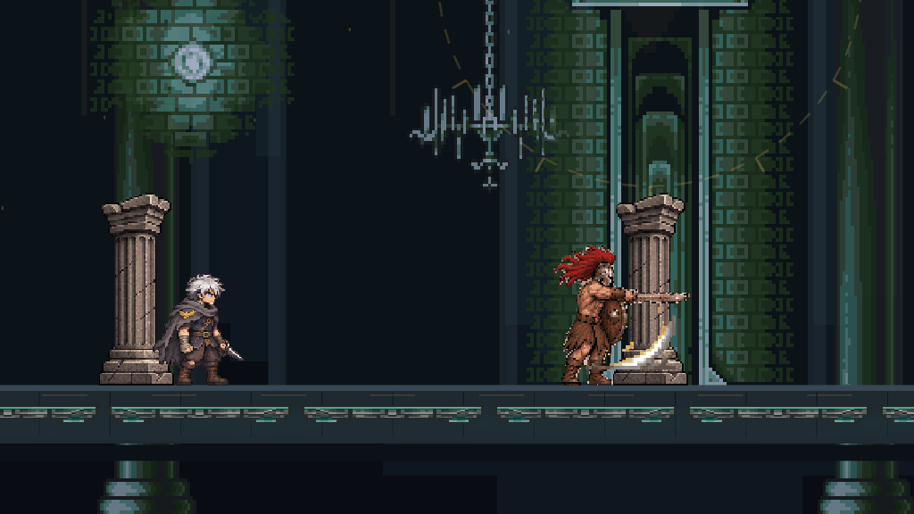
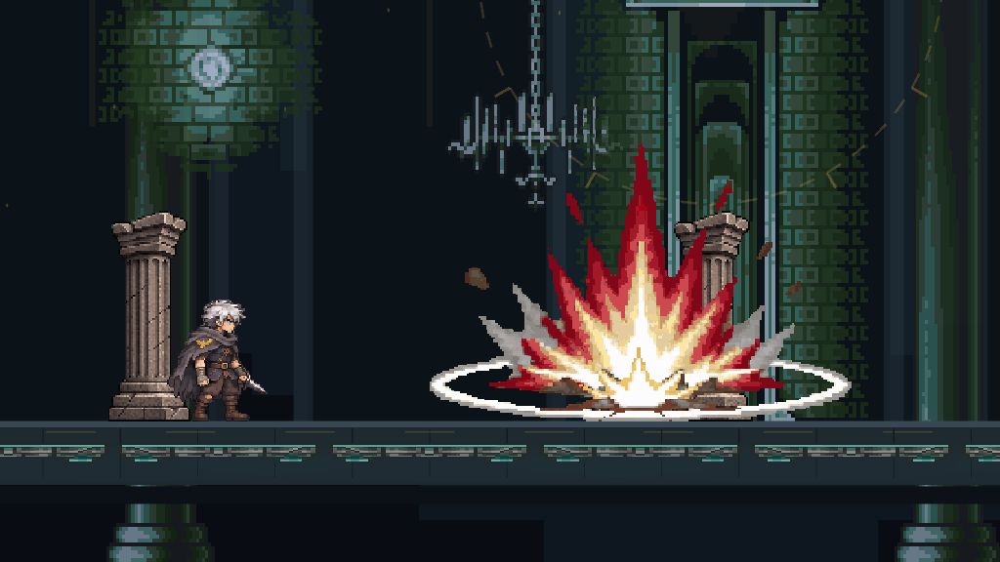
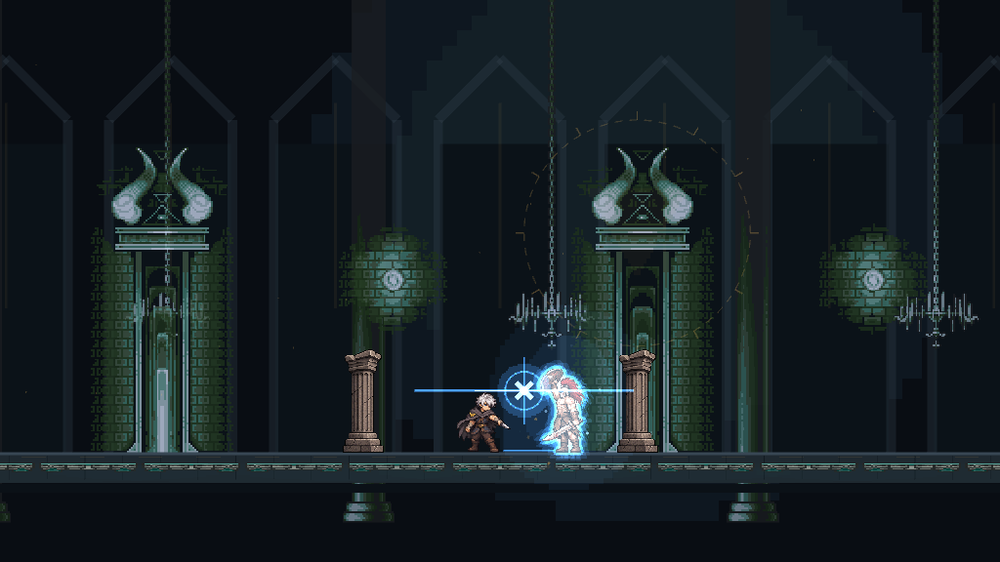

# 아라쿠스 도트 아트 게임 연결

기존 아라쿠스 전투를 새 도트 아트로 표시합니다. 패턴 준비·타격·회복, 방패의 실제 투척/회수, 실제 도약/착지, 기둥 충돌, 분노와 사망 상태를 기존 게임 상태에서 읽습니다. 피해·판정·이동·패턴 선택·쿨타임은 수정하지 않았습니다.

## 적용

- Assets/Resources/ArakusV1: 승인된 34장 시트, 전체179프레임. 캐릭터16종·소품2종·독립 FX16종.
- 기존 Arakus.controller GUID를 유지하고 새16개 클립을 연결했습니다. 옛 상태와 아트는 보존했습니다.
- ActorView.cs: 새 아라쿠스의 프레임을 실제 전투 시간에 맞춰 선택합니다. 주인공의 기존 연결은 유지합니다.
- ArakusVisuals.cs: 기존 투사체 좌표에 회전 방패, ±4 위치의 기둥, 실제 충돌/타격/분노 상태에 FX를 표시합니다. 파손 기둥은 잠깐 보인 뒤 사라집니다. 사망 시 몸에서 분리된 방패를 별도 표시합니다.
- WorldArtist.cs: 새 아라쿠스가 준비된 경우에만 옛 방패/기둥/분노 오라 표시를 생략합니다. 기존 판정 예고·패링 신호와 다른 보스 표시는 유지합니다.
- FoundationSetup.cs: 향후 생성 시에도 기존 컨트롤러를 삭제하거나 옛 아트로 되돌리지 않습니다.

## 크기와 타이밍

기존 ActorView의1.4배와 Prefab을 유지합니다. 가져오기56 PPU로 유효40px/world unit에 맞춰, 기준88px 몸 높이는 약2.2 Unity 단위입니다. Point 필터·압축 없음·밉맵 없음입니다. 오른쪽 원본을 기존 root 방향 배율로 한 번만 뒤집습니다.

문서의 고정 시간보다 실제 런타임 windup/recovery/tempo를 우선합니다. DDA나 분노로 준비 시간이 달라져도 실제 타격 시점에 타격 자세가 나옵니다. 방패 내려찍기는 준비보다 먼저 충격 그림을 보여주지 않으며, 두 투척 패턴의 준비/놓는 그림은 동일합니다. 내려찍기는 실제 shieldCaught와 leaping/struck을 따라 회수·상승·착지를 표시합니다. 일대 휩쓸기는 실제 가로/세로 두 판정에 각각 대응합니다.

현재 게임의 기둥 그로기는3.2초, 일반 패링 경직은 기본0.45초입니다. 문서의5초/2.5초로 바꾸지 않았습니다. 이 PR은 아트 연결이며 밸런스 변경이 아닙니다.

제공된 아트에는 방패를 던진 상태의 별도 피격/대기/도약/착지 변형이 없습니다. 실제 방패가 비행 중일 때는 방패 없는 투척 자세로 대체해 몸과 투사체에 방패가 중복되지 않게 합니다. 회수 지연으로 기존 게임의 안전장치 도약/착지가 진행되는 경우에도 빈손 자세를 유지합니다. 새로운 빈손 변형 그림은 추가로 생성하지 않았습니다.

## 검증

- Tests/ArakusAnimationTests.cs: 422개 확인. 최초420개는 Verify-ArakusAnimation.ps1로 통과했으며, 최종 검사 실행 파일은 PC의 앱 실행 정책에 막혀 동일 테스트 소스를 독립 Unity Editor 검사 어셈블리로 실행했습니다. 정책 변경은 하지 않았습니다. 실제 가변 타격 시각, 방패 대기/회수, 도약/착지, 분노, 그로기, 사망, 시트 범위 검사.
- 기존 Verify-Logic.ps1:119개 통과. 기존 Verify-PlayerAnimation.ps1:177개 통과.
- Unity6000.4.0f1 ArakusSpriteSetup.VerifyAndCapture:155개 확인. 모든179프레임 리소스와 실제 프로덕션 ActorView/Animator의11개 패턴 시각별 자세, 좌우, 도약 좌표, 기둥 그로기, 결과 화면 사망, 방패 중복 방지, 시간 정지와 다른 보스 호환 검증.
- Windows64 빌드 성공. 실행 파일에서 격리 저장의 로비 구매/재로딩/입장/복귀 자동 검사19개 통과.
- 12초 자동 전투 실행에서 예외 없이 전투 진행·피해 발생을 확인했습니다. 보스 처치 성공이나 수동 완주 검사가 아닙니다.

Unity 출력은 제어한 게임 상태를 사용한 실제 카메라 렌더입니다. 개인 저장과 DB 연결을 피하려고 실제 StreamingAssets/supabase.json과 .meta를 제외한 독립 복사본에서 검사했습니다. 자동 실행도 별도 저장 경로를 사용했습니다. 숨김 Windows 실행의 ScreenCapture는 검은 이미지였으므로 정상 화면 증거로 사용하지 않았습니다. 검수 복사본에만 추가한 진단 스크립트로 Windows Player에서179프레임의 실제 로드와 카메라 직접 출력을 확인했습니다(variedWorldPixels=450711). runtime-world.png는 UI를 제외한 실제 실행 중 월드 렌더입니다. 이 진단 스크립트는 제품 소스/PR에는 포함하지 않았습니다.

새로 도입한 동작의 무게감·장비 세부 일관성·이펙트 위치는 사용자 검수가 필요합니다. 사람의 실제 조작으로 전체 전투를 완주하거나 실제 DB에 연결한 검사는 하지 않았습니다.

## 확인과 복구

Unity6000.4.0f1에서 이 브랜치의 TowerProduction 씬을 엽니다. 아라쿠스 입장 후 기존 개발 단축키 F5/F6으로 패턴을 골라 확인할 수 있습니다(에디터/개발 빌드만). 다른 보스와 주인공의 표시도 유지됩니다. 아트 재설정은 Reversal Tower/Install Arakus Pixel Animations 메뉴입니다.

씬·Prefab·기존 컨트롤러 .meta·게임플레이 코드·프로젝트 버전은 수정 전후 해시가 같습니다. 원복이 필요하면 이 PR만 별도 revert PR로 되돌릴 수 있습니다. 기존 아트와 클립은 삭제하지 않았습니다.

