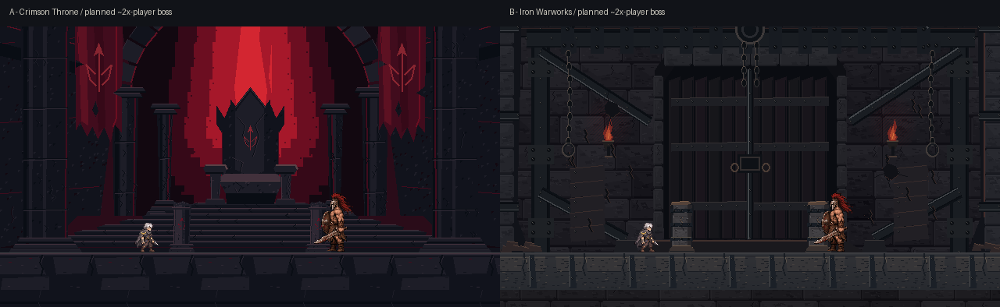
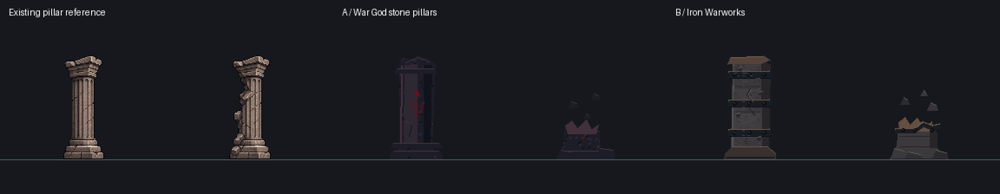
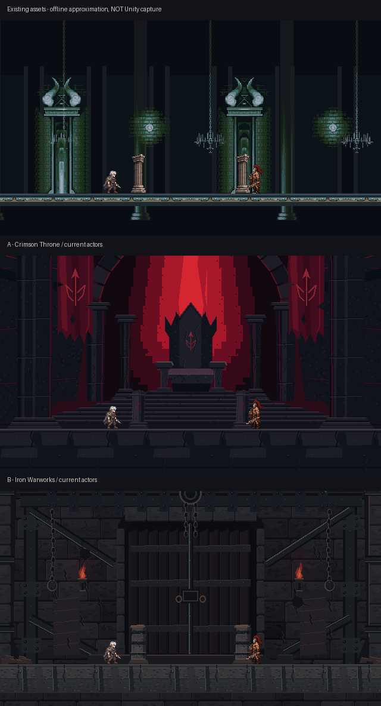

# 아라쿠스 1층 보스룸 — Crimson Throne of the War God

제작일: 2026-11-07(KST). 기준: main `f13bb6bd25f469e38acce05eceb712712dc30c3f`.
브랜치: `feat/arakus-room-art`. **PR #19의 자체 제작 아트·제작 소스·문서만 수정했으며 게임에는 적용하지 않았다.**
기존 Castle/Pillar/캐릭터, 코드, Scene, Prefab, DDA·DB, PR #13~#18은 변경하지 않는다.
사용자 선택과 팀 사전 공유 이후 별도 통합 PR이 필요하다. 팀원 리뷰 없이 병합하지 않는다.

## 1. 두 시안과 추천

| 시안 | 특징 | 판단 |
|---|---|---|
| A: StoneFortress — 검붉은 전쟁신의 왕좌 | 거대한 검은 왕좌·넓은 계단식 제단·붉은 역광·육중한 석주·찢어진 전쟁 군기 | **현재 주력 추천안.** 사용자가 첨부한 왕좌 컨셉의 중앙 대칭 구도와 위계를 픽셀아트로 재설계 |
| B: IronWarworks — 철제 전쟁 시설 | 기존 철제 가새·인양 장치·보강 바닥 | 비교 후보로 원본 그대로 보존. 최신 왕좌 디자인 방향의 대안으로 추천하는 것은 아님 |

사용자가 첨부한 컨셉아트는 **공간 구성과 디자인만 참고**했다. 사진을 축소하거나 필터로 픽셀화하지 않았다.
기존 플레이어·아라쿠스·Castle 배경을 작화 기준으로 검토하고, 제한된 명암 면·1px 균열·도트 군집으로 직접 그렸다.
역광은 5단계 붉은 색띠와 경계에 제한한 2×2 디더링으로 표현하며 블러·부드러운 그라데이션·실사 텍스처를 사용하지 않는다.
왕좌의 뾰족한 등받이, 팔걸이, 좌판, 다리와 아래 계단을 분리했다. 철창문·쇠사슬·감옥 구조는 A에서 제거했다.
높은 석조 아치는 위압적인 성역 구조이며 금색 왕실 장식이나 정교한 성당 조각은 넣지 않았다.
전경은 낮은 명도의 검은 바닥으로 유지하고 붉은 빛은 중앙 후방에 집중했다.

[설계 참고 및 직접 시각 검토](REFERENCE_REVIEW.md) · [이전 A / 새 왕좌 비교](StoneFortress_redesign_comparison.png)



## 2. 실제 게임용 신규 파일

루트: `Assets/StreamingAssets/Art/ArakusRoom/`.
각 `StoneFortress/`, `IronWarworks/`에 아래 동일한 파일 구성이 있다. 총 **12개 RGBA PNG**다. 이번 수정은 A의 6 PNG만 갱신했으며 기존 `.meta`와 GUID는 모두 보존했다.

| 파일 | 해상도 | 의미/기준 |
|---|---|---|
| `room_far.png` | 768×512 | 불투명 원경. A: 왕좌·제단·붉은 광휘·후면 석주·거대 아치 / B: 기존 철문과 요새 |
| `room_mid.png` | 768×512 | 투명 중경. A: 거대한 전면 석주·찢어진 군기 / B: 기존 쇠사슬·철제 프레임 |
| `floor_tile.png` | 128×48 | 수평 반복 바닥. 첫 행이 발을 놓는 표면, 붉은 위험 표시를 닮은 문양 없음 |
| `pillar_intact.png` | 192×192 | A: 검은 석재·전쟁신 문양 / B: 기존 철제 밴드 기둥 |
| `pillar_broken.png` | 192×192 | A: 부러진 석주와 파편 / B: 기존 철제 밴드 잔해 |
| `pillar_sheet.png` | 384×192 | 왼쪽 정상/오른쪽 파괴, 192×192 두 프레임 |

원경과 중경은 가장자리 검은색을 투명키로 지우지 않는다. 중경은 실제 알파 채널을 사용한다.
모든 신규 PNG의 알파는 0 또는 255이며 블러/안티앨리어싱을 사용하지 않았다.
장식 계층 분리로 깊이를 표현하지만 **런타임 패럴랙스 동작을 구현한 것은 아니다.**

기둥 계약:

- 기존 `Resources/ArakusV1/Pillar.png`: 384×192, 두 192×192 프레임.
- 기존 임포트 PPU=56, 각 프레임 Pivot=(0.5, 32/192), 발 경계는 위에서 y=160(마지막 불투명 행 159).
- 신규 정상/파괴 모두 같은 발 기준, 정상 실루엣 높이 120px. 정상 외곽은 기존보다 조금 더 투박하고 넓다.
- 기존 루트 스케일 1.4라면 높이 120/56×1.4 = **3.0 월드 단위**.
- **이 경로의 `.meta`는 StreamingAssets용 DefaultImporter이다.** 위 PPU/Pivot은 향후 Sprite 임포트 계약이지
  현재 게임에 연결된 Sprite 설정이라는 뜻은 아니다. 기존 Resources 파일을 교체하지 않았다.



## 3. 조사한 현재 렌더링과 실제 비율

- `WorldArtist.Render()`는 절차적 배경과 기존 `Art/Castle` 이미지를 함께 그린다.
- 현재 원경 `parallaxBG-interior1.png`: 256×256.
- 현재 중경 `parallaxBG-interior2.png`: 256×320.
- 현재 `twilight-tiles.png`: 256×256. 사용 영역은 Unity 좌표 (0,240,48,16), PNG 위쪽 48×16에 해당한다.
- `ExternalAssets.Texture()`는 `Art/Castle/`만 배경색 투명키 처리를 한다. 새 ArakusRoom은 이 조건에 들어가지 않는다.
- `ExternalAssets.Picture()`는 Sprite PPU를 자른 영역의 **폭**으로 정하고 Pivot=(0.5,0.5)를 사용한다.
- `WorldArtist.Shape()` 인자는 Sprite의 월드 크기 그 자체가 아니라 Transform scale이다.
  폭 w, 원본 가로세로비 H/W, 세로 scale h이면 실제 높이는 `h×H/W`다.
- `ArakusVisuals.Render()`의 게임플레이 기둥 위치는 **x=-4,+4**, 정상 프레임 0/파괴 프레임 1이다.
  현재 파괴 그림은 약 0.6초 페이드 후 사라진다. 잔해의 영구 표시까지 자동 호환되는 것은 아니다.

목업은 현재 Sprite의 불투명 영역과 실제 PPU/스케일을 사용했다.

| 요소 | 기준 | 월드 높이 | 640×360 16:9 목업의 대략 높이 |
|---|---|---:|---:|
| 플레이어 Idle | 93px / PPU75 × 1.4 | 1.736 | 38px |
| 현재 아라쿠스 Idle | 88px / PPU56 × 1.4 | 2.20 | 48px |
| 확대 예정 아라쿠스 | 88px / PPU56 × 2.2 | 3.457 | 76px |
| 게임플레이 기둥 | 120px / PPU56 × 1.4 | 3.00 | 66px |

아라쿠스 확대는 **목업의 가정**이며 이번에 ActorView를 수정하지 않았다.
현재 Root 확대 시 자식 기둥/VFX도 커지는 구조이므로 향후 통합에서는 월드 기둥 크기를 분리해야 한다.
예정 목업은 기둥 높이를 3.0으로 유지하는 디자인 가정이다.
캐릭터는 기존 PNG를 목업에만 사용했다. 새 배경 PNG 안에는 캐릭터가 포함되지 않는다.

## 4. 미리보기 안내

[오프라인 비교 갤러리](review.html)에서 두 시안·현재/확대/가독성·화면 비율을 바꿔 비교할 수 있다.
폴더를 함께 내려받아 review.html을 열면 외부 네트워크 없이 동작한다.
브라우저 정책이 file URL을 차단하면 해당 문서 폴더를 localhost HTTP 서버로 열어 확인한다.
자동 갤러리 검사는 임시 localhost 서버만 사용하고 외부 요청을 차단했다.

각 접두사 `StoneFortress`, `IronWarworks`:

| 접미사 | 해상도 | 내용 |
|---|---|---|
| `_room_16x9.png` | 1280×720 | 캐릭터 없는 전체 보스룸 |
| `_current_mockup.png` | 1280×720 | 기존 플레이어/아라쿠스 크기, 기둥 ±4 |
| `_future_mockup.png` | 1280×720 | 주인공 약 2배 높이 예정 보스 |
| `_room_4x3_crop.png` | 960×720 | 16:9의 중앙 크롭, 구도 비교용 |
| `_future_4x3_crop.png` | 960×720 | 확대 예정 목업 중앙 크롭 |
| `_room_4x3_camera.png` | 960×720 | 실제 카메라 수식 반영, 캐릭터 없음 |
| `_future_4x3_camera.png` | 960×720 | 실제 카메라 수식 반영, 확대 예정 목업 |
| `_readability.png` | 1280×720 | 붉은 예고/파란 패링 색상 대표 표시. 실제 셰이더 재현 아님 |
| `_floor_repeat.png` | 1536×96 | 6번 반복한 바닥, 최근접 2배 표시 |

공통:

- `existing_assets_proxy_16x9.png`: 현재 Castle 에셋·배치·색조를 이용한 **근사 재구성**.
- `existing_vs_concepts.png`: 위 근사 원본과 두 신규 시안의 현재 캐릭터 크기 비교.
- `concepts_future_comparison.png`: 두 시안의 확대 예정 보스 비교.
- `pillar_comparison.png`: 기존 기둥과 A/B 정상·파괴 비교.

**모든 미리보기는 오프라인 합성이다. Unity 실행 캡처가 아니다.** 기존 비교는 절차적 원형 장식/먼지/안개,
HUD/실제 VFX를 완전히 재현하지 않았다. 구도·크기·색상 비교용이며 현재 게임 화면과 동일하다고 주장하지 않는다.
기본 장면은 640×360 논리 픽셀에서 구성하고 미리보기만 최근접 2배 확대했다.
캐릭터별 기존 PPU가 서로 달라서 모든 요소의 원본 픽셀/월드 비율이 완전히 같은 것은 아니다.



## 5. 16:9 / 4:3 카메라와 overscan

현재 `TowerGame.LateUpdate()`:

```text
orthographicSize = max(8.2, 14.3/aspect) - zoomPunch
camera center ≈ (0,5)
```

- 16:9 기본 시야: 약 **29.1556×16.4** 월드 단위.
- 4:3 기본 시야: **28.6×21.45**. 단순 중앙 크롭과 다르게 더 위/아래를 보여준다.
- 제작 원본의 기준 밀도: 360/16.4 = **21.9512195px/world**.
- 원본 768×512는 약 **34.9867×23.3244** 월드를 담아 두 시야와 작은 흔들림을 위한 여유를 둔다.
- 원본 기준점: (384,366)이 바닥 y=0. 카메라 수식 목업은 이 좌표에서 실제 시야를 투영한다.
- 4:3에서는 카메라가 멀어지므로 같은 캐릭터의 화면 높이가 더 작아진다. 이를 확대해서 숨기지 않았다.
- 21:9/초광폭·세로 화면 전체 커버는 보장하지 않는다. 향후 통합에서 벽 확장/타일링/화면 제한이 필요할 수 있다.

## 6. 향후 통합 PR에서 필요한 변경 — 이번에는 미수정

### WorldArtist.cs

1. `bossIndex==0`이며 Battle/Result일 때만 신규 세트 사용. Title/Lobby/다른 층은 기존 분기 유지.
2. 기존 Castle 이미지와 기존 절차적 원형 장식/색상 요소도 해당 분기에서 함께 제외해야 이중 배경을 피할 수 있다.
3. 선택한 `Art/ArakusRoom/<variant>/room_far.png`, `room_mid.png`, `floor_tile.png` 로드.
4. 원경/중경은 서로 다른 렌더 순서로 캐릭터·전투 예고 뒤에 배치. 신규 중경이 HUD/캐릭터 위를 덮지 않게 한다.
5. 바닥은 첫 행을 y=0에 맞추고 반복. 기존 Shape(3,1)을 그대로 쓰면 새 타일의 의도한 비율과 다르다.

현재 Picture/Shape를 그대로 쓸 때의 계산 예(개념안, 실행 코드 아님):

```text
room scale x=y = 768 / 21.9512195 = 34.9867
room center world = (0, (366 - 512/2) / 21.9512195) = (0,5.0111)
실제 room world bounds = 34.9867×23.3244

floor scale x=y = 128 / 21.9512195 = 5.8311
floor world height = 48 / 21.9512195 = 2.1867
floor center y = -1.0933  → 위쪽 경계 y=0
```

바닥은 약 5.8311 월드 간격으로 필요한 개수만큼 반복하고 Clamp를 유지한다.
리사이즈·화면 흔들림·최종 카메라 조정 후 가장자리 빈틈 여부를 다시 확인한다.

### ArakusVisuals.cs / 선택 에셋 임포트

현재 `Resources.LoadAll<Sprite>("ArakusV1/Pillar")`는 신규 StreamingAssets 시트를 읽지 않는다.
선택 후 다음 중 하나를 별도로 승인받아 적용한다.

- 선택 시트를 **새 Resources 경로**로 추가하고 Sprite Multiple, 192×192 두 영역,
  PPU56, Pivot(0.5,32/192), Point/no mipmap/uncompressed로 임포트한 뒤 1층 경로만 연결.
- 또는 StreamingAssets 시트의 캐시 Sprite 생성에 PPU/Pivot을 명시하는 전용 로더를 추가.

현재 `ExternalAssets.Picture()`의 중앙 Pivot/폭 PPU로 기둥을 그냥 읽으면 발 정렬과 크기가 달라진다.
기존 Pillar.png·GUID를 덮어쓰지 않는다. `ArakusSpriteSetup.Install`은 기존 아트용 전체 임포터이므로
이번 후보를 확인하려고 무심코 실행하거나 기존 Resources 파일을 교체하지 않는다.

기둥 좌표 ±4는 유지한다. 외형의 폭 변화는 논리 충돌 반경 변경을 뜻하지 않는다.
보스 확대 시 기둥/VFX가 부모 스케일을 상속하지 않도록 별도 크기를 유지해야 한다.
파괴 잔해를 계속 보이게 할지는 기존 0.6초 페이드 정책과 구분해 결정한다.

### 외부 로더 / Scene

새 경로에는 Castle 전용 색상키가 적용되지 않으므로 RGBA alpha를 그대로 쓰면 된다.
기본 배경 로딩에는 ExternalAssets 공통 코드 변경이 필수는 아니다. 기둥 전용 PPU/Pivot 로딩은 별도 검토한다.
기존 런타임 방식이면 Scene/Prefab 변경 없이 통합할 수 있다.
Editor 기반 배치를 선택하면 ScenePresentation·TowerProduction.unity 수정 범위를 팀과 먼저 공유한다.

## 7. 품질 검사와 한계

실행:

```sh
python3 Docs/Art/ArakusRoomConcept/create_assets.py
python3 Docs/Art/ArakusRoomConcept/verify_revision.py
python3 Docs/Art/ArakusRoomConcept/validate_assets.py
python3 Docs/Art/ArakusRoomConcept/verify_gallery.py
```

Python + Pillow가 필요하다. 생성기는 고정 seed와 손으로 배치한 구조/재질을 사용한다.
승인된 ArakusRoom 경로의 자체 산출물만 재생성한다. Castle/Resources 원본은 수정하지 않는다. 기존 캐릭터/배경은 문서 목업에서만 읽는다.
`asset_manifest.json`은 에셋 크기/SHA-256/기준점을, `quality_report.json`은 검사 원본 결과를 담는다.

신규 아트·목업 PNG 34개를 재생성해 모두 바이트 일치를 확인했다(`reproduction_report.json`).
오프라인 HTML 갤러리는 Chromium/Playwright로 7개 보기의 이미지 로드, 데스크톱 2열/좁은 화면 1열과
페이지 오류 없음을 검사했다(`gallery_test_report.json`). Unity 실행을 뜻하지 않는다.

자동 **80 PASS / 0 FAIL**:

- 12 PNG의 규격/RGBA/이진 알파, 원경 불투명·중경 투명 분리.
- 바닥 양 끝 색상 차이 0, 6회 반복 이미지 시각 검토.
- 정상/파괴 시트 조립 일치, 동일 발 기준, 프레임 외곽 잘림 없음, 정상 높이 120px.
- 실제 16:9·4:3 기본 시야가 overscan 안에 포함됨.
- 신규 meta GUID 중복 없음, 기존 코드/Scene/Prefab/캐릭터/Castle/Pillar 변경 없음.
- 선정한 **하단 중앙 배경 구간**에서 예고 빨강 약 **3.109:1**, 패링 파랑 약 **3.691:1**의 최소 명암 비율.
  이는 해당 정적 배경 표본의 디자인 지표이며 전 화면/캐릭터/기둥/셰이더의 접근성 인증이 아니다.

왕좌 개편 후 위 자동 검사를 다시 실행했다. 이번 도트 정제에서는 석재 명암을 제한된 팔레트로 묶고, 작은 잔입자 대신 각진 도트 군집을 사용했다.
[도트 정제 전후 비교](StoneFortress_style_comparison.png)와 [변경 내용](STYLE_REFINEMENT.md)을 참고한다.
추가 보존 검사는 `revision_preservation_report.json`에 기록한다.
시각 검토에서는 첨부 컨셉의 왕좌/제단/광휘/석주 배치를 비교하고, 실제 캐릭터 목업·4:3·기둥·바닥 반복·대표 예고 색상을 확인했다.
이는 제작자의 시각 검토이며 사용자 최종 미술 승인이나 Unity 실전 검증을 대체하지 않는다.

Unity 임포트·실제 Sprite 샘플링·발광·전투 중 화면 흔들림·HUD 겹침·Windows 빌드는 **미검증**이다.
실제 패링 광원은 이 목업의 파란 선과 다르며, Rage/피격/공격 예고를 포함한 실전 가독성을 추가로 확인해야 한다.
아트는 제작했지만 게임 적용이 완료됐다고 판단하지 않는다.

## 8. 사용자 선택 및 Unity 인수 확인

1. A/B를 선택하고 다른 후보도 보존한다.
2. 팀에 WorldArtist/ArakusVisuals/선택 임포트 및 필요한 공통 코드 범위를 사전 공유한다.
3. 별도 통합 브랜치에서 1층 Battle/Result에만 연결한다.
4. 16:9·4:3, 현재/확대 보스, 좌우 이동 끝, 도약·기둥 충돌·파괴·Rage를 확인한다.
5. 빨강 예고·파랑 패링·캐릭터 발·UI가 묻히지 않는지 실제 게임 캡처로 리뷰한다.
6. 기존 다른 층/Title/Lobby를 비교하고 Windows 빌드를 확인한다.

지금은 두 시안 모두 게임에 연결하지 않은 상태로 유지한다. 사용자 확인 없이 보스룸을 교체하지 않는다.
