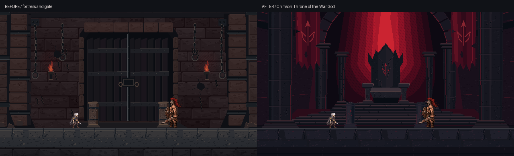

# StoneFortress 재설계 — 검붉은 전쟁신의 왕좌

## 기준 및 작업 범위

사용자가 대화에 첨부한 붉은 왕좌 이미지를 직접 확인하고 **구도·구조·색감·위압감**의 우선 기준으로 삼았다.
첨부 이미지는 실사풍이므로 그 질감·부드러운 조명은 옮기지 않았다. 이미지 픽셀을 샘플링하거나 자동 픽셀화하지 않고
기존 게임의 플레이어·아라쿠스·Castle PNG를 작화 기준으로 삼아 Pillow의 정수 좌표 도형과 도트로 다시 설계했다.
원본 참고 이미지는 저장소에 복제하지 않는다. 본 문서의 비교 이미지는 이전 자체 제작 A안과 새 자체 제작 A안 비교다.

브랜치와 PR은 기존 `feat/arakus-room-art`, Draft PR #19를 그대로 사용한다.
이전 A안은 Git `b7210c075badc9533c7418f5410bf0d74983d820`에 보존되어 있다.
IronWarworks, 게임 코드, Scene, Prefab, 원래 Castle/Pillar/캐릭터, Unity .meta는 변경하지 않는다.

## 첨부 컨셉 → 픽셀아트 해석

| 참고 요소 | 새 실제 에셋 반영 | 횡스크롤을 위한 조정 |
|---|---|---|
| 중앙 검은 돌 왕좌 | room_far의 뾰족한 등받이·두 팔걸이·좌판·하부 다리 | 실루엣을 굵게 분리하고 날개 모양의 거친 석재 꼭대기 추가 |
| 낮고 넓은 제단 | 여덟 층으로 넓어지는 검은 계단 | 실제 이동 바닥과 구분되는 후방 장식. 계단 Collider 추가 없음 |
| 위에서 내리는 진홍 광휘 | 중앙 수직 광주와 주변 8단계 색띠·도트 전이 | 광원은 배경에만 고정, 전투 바닥은 어두운 상태 유지 |
| 거대 석주와 높은 아치 | room_far의 원경 열주·큰 석조 아치, room_mid의 굵은 양쪽 석주 | 화면비 변경에도 중심 왕좌가 남도록 대칭 구성 |
| 찢어진 검붉은 전쟁 군기 | room_mid 좌우 두 군기, 찢긴 밑단·천 주름·갈라진 창 문양 | 금색 테두리·왕관·화려한 귀족 장식 배제 |
| 감옥 분위기 제거 | A의 철창문·철제 밴드·쇠사슬·인양 구조를 제거 | B는 기존 비교용으로 보존하며 새 디자인 방향과 혼동하지 않음 |

## 픽셀 작화 기준

- 768×512 원본의 정수 픽셀에서 그린 면·균열·칩·도트 군집. 실사 텍스처와 블러를 쓰지 않는다.
- 검은 석재는 먹색/차가운 회보라 계열 명암 면, 천은 어두운 진홍색 면으로 구분한다.
- 붉은 광휘는 밝은 중앙과 어두운 가장자리를 불연속 색띠/디더링으로 표현한다. 부드러운 그라데이션이 아니다.
- 목업은 기존 실제 캐릭터를 PPU/스케일에 맞춰 사용하며, 최근접 보간으로 표시한다.
- 배경의 디자인 밀도는 단순화했다. 기존 스프라이트의 세부 도트 묘사와 완전히 동일하다고 단정하지 않는다.
  게임 적용 후 실제 샘플링과 조명 아래에서 최종 미술 리뷰가 필요하다.

## 직접 시각 검토 결과

검토 대상: 16:9 확대 예정 보스 목업, 4:3 카메라 목업, 정상/파괴 기둥 비교, 바닥 반복, 대표 빨강/파랑 표시 목업.

- 중앙에서 왕좌의 등받이와 팔걸이, 아래의 넓은 계단이 읽힌다. 이전 A의 거대한 문 중심 구도를 제거했다.
- 왕좌 뒤 붉은 빛과 검은 석주의 대비를 강조했다. 좌우 군기의 문양과 찢어진 가장자리가 드러난다.
- 4:3 실제 카메라에서는 더 넓은 세로 영역이 보이며, 양쪽 군기와 왕좌가 유지된다.
- 확대 예정 보스와 주인공은 낮은 명도의 전투선 앞에서 구분된다. 장식 석주와 낮은 게임플레이 기둥은 별개다.
- 정상/파괴 게임플레이 기둥은 동일한 마지막 불투명 행 y=159를 유지한다. 파괴 잔해를 실제로 오래 표시하는 코드는 추가하지 않았다.
- 바닥 반복 경계의 좌우 픽셀은 일치한다. 큰 돌판의 반복 리듬은 남으며, 실제 이동 카메라에서 최종 확인해야 한다.
- 대표 빨강 예고/파랑 패링 표시는 목업에서 구분된다. 실제 셰이더·Rage·HUD·피격 플래시 가독성은 검증하지 못했다.

[이전 A와 새 왕좌 비교](StoneFortress_redesign_comparison.png)



## 재현 및 검사

```sh
python3 Docs/Art/ArakusRoomConcept/create_assets.py
python3 Docs/Art/ArakusRoomConcept/verify_revision.py
python3 Docs/Art/ArakusRoomConcept/validate_assets.py
python3 Docs/Art/ArakusRoomConcept/verify_gallery.py
```

첫 세 명령은 Pillow가 필요하고 마지막은 Playwright/Chromium 및 로컬 HTTP 포트 사용 권한이 필요하다.
verify_revision은 원래 PR #19 커밋을 Git에서 읽어 변경 전 비교를 생성하며, 34개 생성 PNG의 재현성과 보존 범위를 검사한다.

- 자동 아트 검사: **80 PASS / 0 FAIL** (`quality_report.json`). 규격·알파·반복·발 기준·시야 범위 등.
- 보존/재현 검사: **4 PASS / 0 FAIL** (`revision_preservation_report.json`). .meta 15개, B 관련 21개 보존, 수정 범위 제한, 34 PNG 바이트 재현.
- 미술 판단은 위 자동 검사와 별개다. 컨셉의 사실적인 표면 질감은 의도적으로 재현하지 않는다.
- Unity 실행/임포트/Windows 빌드는 수행하지 않았다. 아트는 아직 런타임에 연결하지 않았다.

## 별도 통합 시 필요한 작업

README의 WorldArtist 1층 전용 분기, Castle 배경 중복 제거, 원경/중경 렌더 순서, 바닥 y=0/반복 배치,
ArakusVisuals 신규 기둥 로더와 PPU56/발 Pivot 계약을 따른다. 이 작업에서는 해당 코드를 수정하지 않는다.
사용자 미술 확인과 팀 사전 공유 후 별도 통합 PR에서 16:9·4:3, 현재/확대 보스, 좌우 끝 이동,
점프·돌진·기둥 파괴·Rage·패링, HUD/결과 화면을 실플레이 검증해야 한다.
