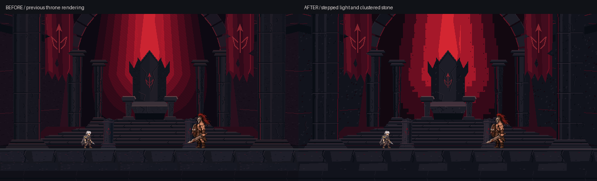

# StoneFortress — 캐릭터와 맞추는 도트 정제

## 수정 목적

왕좌안의 구도를 유지하면서, 기존 플레이어·아라쿠스와 나란히 배치했을 때 배경만 매끈하게 보이는 점을 조정했다.
작화 비교에는 실제 캐릭터를 합성한 현재/확대 예정 목업을 사용했다. 아래 검증은 오프라인 제작 검사이며 Unity 실행 결과가 아니다.

## 줄인 것 / 강화한 것

- 붉은 광휘: 8색에서 5색의 저작 팔레트로 단순화. 매 픽셀 연속 계산 대신 4px 격자에 계단식 색띠를 그린다.
  촘촘한 전면 디더링은 제거하고 색띠 경계 일부에만 2×2 군집을 사용한다.
- 석재: 임의의 작은 중간색을 제한 팔레트로 통합했다. 외곽/그림자/중간 면/밝은 면과 드문 칩 하이라이트가 분리된다.
- 표면: 가는 잔입자 대신 드문 2~4px 각진 군집, 제한된 균열과 1~2px 모서리 하이라이트를 사용한다.
- 바닥: 잔무늬 생성 횟수를 80에서 22로 줄여 전투선 주변을 조용하게 했다. 수평 반복 경계와 발 기준을 유지한다.
- 같은 색을 모든 캐릭터에 강요하지 않았다. 어두운 배경 재질과 붉은 천/광원은 별도 색군으로 유지한다.
  기존 캐릭터의 원본 팔레트와 텍스처에는 손대지 않았다.

## 실제 PNG의 불투명 RGB 색 수

픽셀을 직접 세었다. 투명색은 제외한다. 색 수 감소는 제한 팔레트의 근거이며, 미술 품질이나 스타일 일치의 수치 인증은 아니다.

| 파일 | 직전 왕좌안(fc7bbea) | 도트 정제 후 |
|---|---:|---:|
| room_far.png | 80 | 15 |
| room_mid.png | 28 | 10 |
| floor_tile.png | 15 | 7 |
| pillar_intact.png | 18 | 5 |
| pillar_broken.png | 14 | 5 |
| pillar_sheet.png | 31 | 6 |

## 유지한 것

중앙 검은 석조 왕좌, 계단식 제단, 내려오는 진홍 역광, 거대한 양쪽 석주, 찢어진 전쟁 깃발과 문양,
좌우 대칭의 성역 구도는 유지했다. 6 PNG의 알파 실루엣도 직전 왕좌안과 동일하다.
기존 해상도/경로/파일명과 .meta 15개의 전체 바이트를 보존했다. IronWarworks 관련 21개 파일도 동일하다.

## 비교 및 검증

- 기존 자동 아트 검사: 80 PASS / 0 FAIL.
- 보존/재현/팔레트 검사: 6 PASS / 0 FAIL. 생성 PNG 34개 재생성 바이트 일치.
- 갤러리: 7개 보기 로드, 데스크톱 2열/좁은 화면 1열, 페이지 오류 없음.
- 16:9 캐릭터 목업을 직접 비교했다. 붉은 역광의 계단과 색면이 더 분명하고 바닥 잔무늬가 줄었다.
- Unity의 실제 Sprite 샘플링, 화면 흔들림, 동적 VFX 및 HUD 가독성은 미검증이다.
- 게임 코드/Scene/Prefab, DDA/DB, 기존 캐릭터/배경 파일은 변경하지 않았다. 실제 게임 연결은 하지 않았다.

생성: create_assets.py → verify_revision.py → validate_assets.py. 브라우저 검사는 verify_gallery.py.
