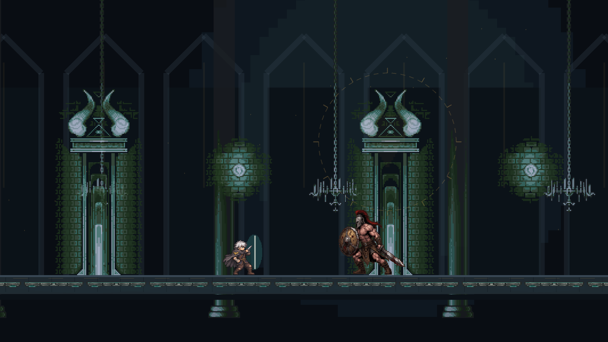
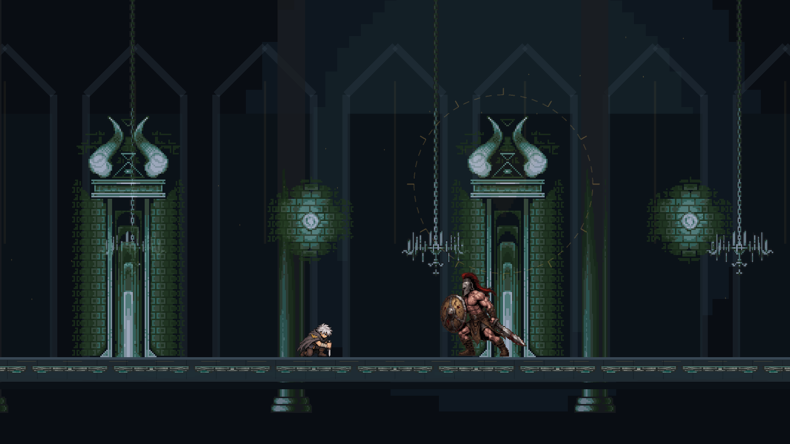

# 주인공 추가 애니메이션 적용

패링·대시·사망·Q/W/E·점프·낙하·궁극기 5종을 기존 주인공에 연결했습니다. 기존 4종을 포함해 그림은 17종 114프레임입니다. 기존에는 Q/W/R이 공통 Skill 동작, E가 기본 Attack 동작을 사용했으나 이제 각 동작을 선택합니다.

## 변경 범위

- 공통 코드: `Assets/Scripts/ActorView.cs`, `Assets/Editor/FoundationSetup.cs`.
- 추가 코드: `PlayerAnimationSelection.cs`, `PlayerExtendedSetup.cs`.
- 기존 주인공 `Player.controller`를 갱신하고 GUID를 유지했습니다. 기존 `Run` 상태에는 새 Walk 시트를 연결하고, 옛 `Skill` 상태는 호환 별칭으로 남겼습니다.
- 새 아트는 `Assets/Art/Player/SilverRogueExtended`, 새 클립은 `Assets/Animation/PlayerExtended`에 추가했습니다. 이전 아트와 클립은 삭제하지 않았습니다.
- `TowerProduction.unity`, `Player.prefab`, 보스 컨트롤러·Prefab, 프로젝트 버전, DB 설정은 수정하지 않았습니다.

## 동작 선택과 시간

J 기본 공격, K 패링, Shift 대시, Q 돌진 베기, W 회전 베기, E 처형 베기, 상승/낙하, 피격/사망에 대응합니다. 포션 F의 그림은 기존처럼 Idle을 유지합니다. 사망은 결과 화면에서도 끝까지 진행하고, 승리 화면에서는 남은 공격 자세에 고정되지 않습니다. 전투 시간 기준으로 애니메이션을 샘플링하므로 일시정지와 히트스톱 중에는 진행하지 않습니다.

Q/W/E와 궁극기는 게임의 기존 피해 판정 시각에서 해당 타격 자세가 나타나도록 준비·회복 구간을 나눠 샘플링합니다. 피해량·쿨타임·이동·점프 물리와 판정은 수정하지 않았습니다. 파네스의 기존 5발 발사는 그대로이며 그림에 맞춰 추가 발사하지 않습니다. 기본 궁극기에 새 전기탄 로직을 추가하지 않았습니다. 회복/광역 효과도 기존 게임 규칙을 유지합니다.

| 장착 값 | 동작 |
|---:|---|
| -1 | UltimateBasic |
| 0 아라쿠스 | UltimateArakus |
| 1 파네스 | UltimatePhanes |
| 2 아디쿠스 | UltimateAdikus |
| 3 에텔로스 | UltimateAethelos |
| 4 카로스 및 미지원 값 | UltimateBasic 시각적 대체. 기존 판정은 유지 |

새 원본은 왼쪽을 보므로 SpriteRenderer의 flipX와 기존 루트 방향 배율을 조합합니다. 기존 주인공의 75 PPU와 1.4 배율을 유지하고, 확대 없는 192px 여백 캔버스의 발 기준점을 맞췄습니다. 새 프레임의 세부/체격 차이와 움직임의 자연스러움은 팀 검수가 필요합니다.

## 검증

- `Verify-Logic.ps1`: 기존 전투/저장/DDA 등의 119개 검사 통과.
- `Verify-PlayerAnimation.ps1`: 상태 우선순위, 패링 성공 후 회복, 대시 취소, Q/W/E/궁극기 선택, 타격 전·판정 순간 자세, 사망·점프 최종 자세, 낙하 반복, 경계값 등 177개 검사 통과.
- 팀 기준 Unity 6000.4.0f1에서 컴파일과 기존 Foundation 검증 통과.
- 실제 DB 설정을 복사하지 않은 독립 검수본에서 `PlayerExtendedSetup.VerifyAndCapture`를 실행했습니다. 실제 `ActorView.Render`를 사용해 17개 상태·타격 자세·양방향을 검사했습니다.
- 본편의 ScenePresentation과 WorldArtist를 사용한 출력 이미지를 첨부했습니다. 게임 상태는 통제된 검수용 입력이며 수동 플레이 완주를 뜻하지 않습니다. 캔버스 UI는 이미지에서 숨겼습니다.
- 씬·Prefab·컨트롤러 GUID 메타·Unity 버전 파일은 검수 전후 해시가 동일했습니다.
- Windows 실행 파일 빌드, 실제 키 입력 플레이 완주, DB 연동은 이 작업에서 검증하지 않았습니다. `Build-Preview.ps1`의 별도 WinForms 경량 프리뷰 경로는 기존 아트를 유지합니다. 이번 적용 대상은 Unity 본편입니다.

## 팀원 확인 방법

1. 이 작업 브랜치를 받아 Unity 6000.4.0f1로 엽니다. 새 PNG와 `.meta`를 함께 받아야 합니다.
2. 실제 DB가 필요 없는 검수는 별도 복사본에서 `StreamingAssets/supabase.json`을 제외하고 진행합니다. 공유 원본에서 삭제해 커밋하지 않습니다.
3. `TowerProduction` 씬에서 J/K/Shift/Q/W/E/R과 점프·낙하·피격·사망, 좌우 방향, 일시정지와 타격 순간을 확인합니다.
4. 장착한 궁극기별 동작과 발 위치를 확인합니다. 카로스의 새 그림은 제공되지 않았으므로 기본 궁극기 대체 동작임을 확인합니다.
5. 그림만 빠르게 확인하려면 저장소의 `previews/silver-rogue-v3/index.html`을 내려받아 브라우저로 엽니다.

## 협업·복구

최신 main `2e8bcd8b3df0dd0d9ff547caebe90b841392174f`에서 `art/player-extended-animations-20261104` 브랜치를 만들었습니다. 기존 제작 ZIP을 별도로 보존했습니다. main 직접 push와 force push를 하지 않으며, 다른 팀원 1명 확인 후 병합 담당자가 하나씩 병합합니다. 병합 전에는 이 PR을 반영하지 않으면 기존 main이 유지됩니다. 병합 후 되돌릴 때는 이 PR의 변경을 별도 revert PR로 되돌리고 기존 아트를 유지합니다.
