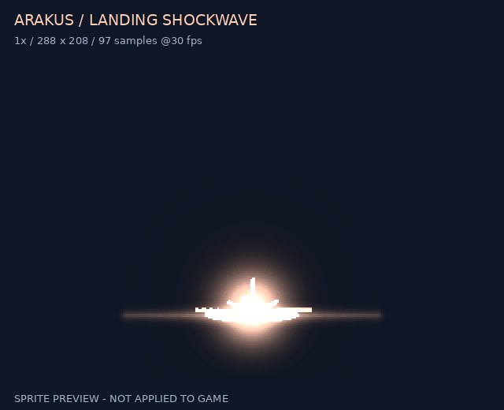
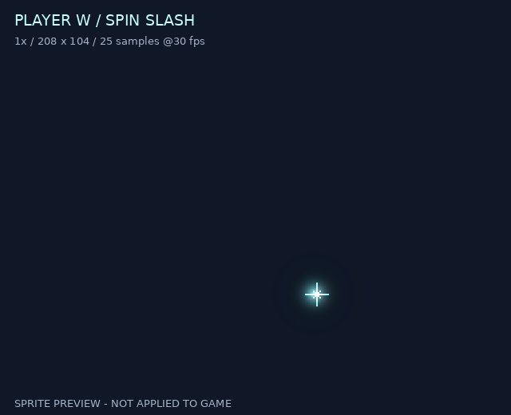
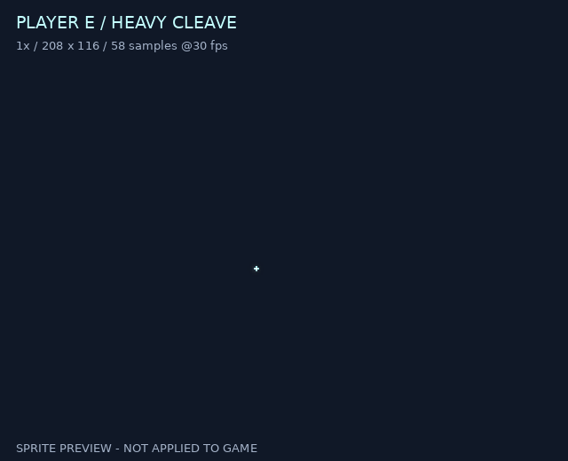

# 보스·플레이어 스킬 이펙트 후보 3종

**팀 검토용 소재입니다. 본편에 적용하지 않았으며, 기존 패링 효과는 그대로 유지합니다.**

## 보는 방법

- **PC:** 이 페이지를 아래로 내려 GIF 3개를 보면 됩니다. 작으면 이미지를 눌러 GIF 파일 페이지에서 확대하세요.
- **모바일:** 같은 링크를 브라우저에서 열고 아래로 스크롤하세요. 앱에서 움직이지 않으면 브라우저로 열거나 GIF의 **Raw / Download raw file**을 누르세요.
- **다운로드:** GIF 또는 PNG 파일 링크 → **Download raw file**(다운로드 아이콘). 팀 채팅에는 이 페이지 주소 또는 GIF 개별 링크를 공유하세요.
- `.png`는 게임에 가져올 **투명 스프라이트시트**, `.json`은 프레임/피벗 정보입니다. 움직임을 보는 용도는 `.gif`입니다.
- 전체 저장소를 받을 필요는 없습니다. 원한다면 저장소의 **Code → Download ZIP**에서 `art/skill-fx-previews-20261113` 브랜치가 선택됐는지 확인하세요.

## 1. 아라쿠스 착지 충격파

붉은 갈색 충격파, 돌 파편, 먼지. 방패 회수 뒤 착지 내려찍기에 사용할 후보입니다.

[GIF 열기](arakus-landing.gif) · [투명 PNG](arakus-landing.png) · [프레임 JSON](arakus-landing.json)

## 2. 플레이어 W 회전 검기

청록색 원형 검기. 주변 범위 공격의 방향과 궤적을 읽기 쉽게 만드는 후보입니다.

[GIF 열기](player-w-spin.gif) · [투명 PNG](player-w-spin.png) · [프레임 JSON](player-w-spin.json)

## 3. 플레이어 E 처형 내려베기

청백색 큰 내려베기와 착지 파편. 강공격에 사용할 후보입니다.

[GIF 열기](player-e-execution.gif) · [투명 PNG](player-e-execution.png) · [프레임 JSON](player-e-execution.json)

## 적용 전 알아둘 점

- 위 GIF는 **소재만 재생한 미리보기**이며 실제 Unity 본편에서 찍은 영상이 아닙니다.
- 3종 모두 30fps입니다. GIF는 10ms 단위 시간 반올림과 마지막 0.6초 쉼을 포함합니다. 같은 연속 이미지는 GIF에서 병합될 수 있습니다.
- 셀은 착지 288×208 / W 208×104 / E 208×116, 실제 프레임 수는 각각 97 / 25 / 58개입니다.
- 착지 먼지 잔상이 남는 동안 계속 공격 판정이 있다는 뜻은 아닙니다.
- W는 게임 동작 시작 +0.35초, E는 +0.7초에 타격 판정이 납니다. 새 소재의 피크는 각각 +0.17초, +0.335초이므로 실제 적용 시 재생 시작 오프셋을 맞춰야 합니다.
- 캐릭터를 가리는 정도·픽셀 크기·히트스톱 영향을 별도 씬에서 검증한 뒤 적용해야 합니다. 현재 시트는 전경/후경을 합친 초안입니다.
- Unity 가져오기와 좌표는 [사용 안내](README-ko.txt), [검증 메타데이터](verified-metadata.json)를 참고하세요.
- 이 브랜치에는 자료 파일만 추가했습니다. 게임 코드·씬·Prefab·기존 효과·패링·배포 설정을 수정하지 않았습니다. **병합/배포하지 않았습니다.**

## 출처·라이선스

- 원본: [patch-gg/pixelfx](https://github.com/patch-gg/pixelfx)
- 고정 커밋: [`5294518ce7c72e48b6100a744596e0acf57f2826`](https://github.com/patch-gg/pixelfx/tree/5294518ce7c72e48b6100a744596e0acf57f2826)
- 원본 효과: `impacts/ground-slam`, `melee/spin-slash`, `melee/heavy-cleave`.
- 이 자료는 원본 효과의 팔레트/일부 옵션을 변경해 출력했습니다. 신규 수작업 캐릭터 애니메이션이 아닙니다.
- [MIT 라이선스](LICENSE), [저작권/출처 고지](NOTICE.md)를 함께 보존하세요. Sprite Fusion/Hugo Duprez 기반 요소가 포함됩니다.
- `gallery/fonts`의 별도 라이선스 폰트는 포함하지 않았습니다.
