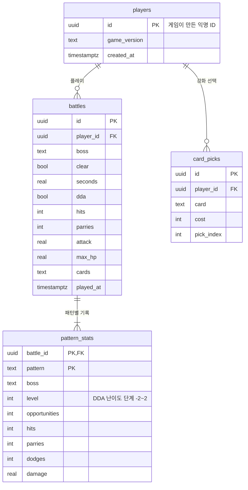

# 전투 기록 DB (Supabase)

전투가 끝날 때마다 기록을 Supabase(PostgreSQL)에 올리고, 모든 플레이어의 패턴별 성공률로 **처음 만나는 보스의 시작 난이도(DDA)** 를 정합니다.
인터넷이 없거나 설정 파일이 없어도 게임은 그대로 동작합니다. 보내지 못한 기록은 쌓아 두었다가 다음 실행 때 다시 보냅니다.

## 구조

| 이름 | 종류 | 용도 |
|---|---|---|
| `players` | 테이블 | 익명 플레이어 (개인정보 없음) |
| `battles` | 테이블 | 전투 한 판 결과 |
| `pattern_stats` | 테이블 | 전투 안의 패턴별 패링·회피·피격 |
| `card_picks` | 테이블 | 로비 강화 카드 선택 |
| `pattern_difficulty` | 뷰 | 패턴별 전체 성공률 → 추천 시작 난이도 (게임이 읽음) |
| `boss_summary` | 뷰 | 보스별 클리어율·평균 시간·평균 패링 (발표용) |
| `card_popularity` | 뷰 | 카드 인기 (발표용) |

## 데이터 흐름

1. 전투 종료 → `SaveStore.Log`가 로컬 CSV를 쓰고 `BattleLogged` 이벤트를 냄
2. `CloudSync`가 `players` → `battles` → `pattern_stats` 순서로 보냄 (실패하면 `CloudQueue` 폴더에 보관 후 재전송)
3. 게임 시작·전투 종료 때 `pattern_difficulty`를 받아 `CommunityStats`에 저장
4. 다음 전투 준비(`DdaBattleSession.Prepare`)에서, **그 보스를 처음 만나는 경우** 패턴별 추천 난이도(-1·0·+1)로 시작. 이후에는 개인 기록으로 학습(LinUCB)

## 보안 (RLS)

게임에 들어가는 공개 키로는
- 원본 테이블: **추가만** 가능 (조회·수정·삭제 불가)
- 집계 뷰: **조회만** 가능

그래서 공개 키가 게임 파일에 들어 있어도 다른 사람의 원본 기록을 읽거나 지울 수 없습니다. `service_role` / secret 키는 절대 게임이나 저장소에 넣지 않습니다.

## 설정 방법

1. Supabase에서 프로젝트 생성 (Region: Northeast Asia (Seoul))
2. SQL Editor에 `supabase_schema.sql` 전체를 붙여 넣고 Run
3. Project Settings → API에서 **Project URL**과 **공개 키**(anon 또는 publishable) 복사
4. `Assets/StreamingAssets/supabase.example.json`을 복사해 `supabase.json`으로 만들고 두 값을 넣기
5. 게임 실행 → 전투 한 판 → Supabase Table Editor의 `battles`에 행이 생기면 성공
