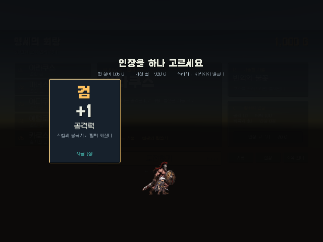

# 카드 선택 연출의 로비 입력 차단

카드 결제 직후 `showCards`가 false로 바뀌지만 약 0.66초의 선택 연출은 남아 있었습니다. PR #9는 이 구간의 `cardsGroup.blocksRaycasts`도 false로 바꾸므로 뒤쪽 로비 클릭과 단축키가 먼저 활성화될 수 있었습니다.

선택 연출과 종료 프레임까지 별도 입력 차단 상태를 유지합니다. 로비 CanvasGroup, 로비 버튼 콜백, TowerGame의 화면 단축키가 같은 상태를 따릅니다. 카드 화면의 Dim은 사라질 때까지 클릭을 받으며, 카드 자체의 클릭은 막되 선택 카드의 색과 확대 연출은 유지합니다. 결제는 기존처럼 즉시 한 번 처리합니다.

수정 대상은 NativeGameUI.cs와 TowerGame.cs입니다. 기존 씬·Prefab·DB 설정·구매 규칙·금액은 수정하지 않았습니다. 화면 입력을 읽는 부분을 HandleScreenInput으로 묶어, 실제 키 신호를 주입하는 회귀 검사에서도 같은 경로를 사용합니다.

## 검증 결과

- 수정 전 Unity에서 입력 누출 재현: CARD_INPUT_BASELINE_REPRODUCED, 8개 확인. 연출이 보이는 동안 뒤쪽 보스 선택 콜백으로 선택이 바뀌었습니다.
- Verify-Logic.ps1: 기존 로직 119개 통과. 디스크 저장 실패 메시지 1건은 기존 롤백 검사의 의도된 실패 상황입니다.
- Unity 6000.4.0f1의 CardTransitionVerify.Verify: 69개 확인 통과.
- 0초·0.33초·0.65초·0.66초의 연출 구간에 실제 GraphicRaycaster가 뒤쪽 입장 버튼 위치에서 카드 화면을 선택하고, 입장 버튼은 비활성 상태인 것을 확인했습니다.
- Enter·좌우·C·Esc·F1 신호와 뒤쪽 버튼 콜백 차단, 중복 구매 방지, 종료 프레임 소비, 다음 프레임 복구, 구매 실패 후 취소, Esc와 Enter 동시 입력, 화면 전환, 비활성화/재활성화 복구를 확인했습니다.

검수는 DB 설정 파일을 제외한 독립 복사본과 매번 새로 만든 격리 저장 폴더를 사용했습니다. 기존 개인 저장은 변경하지 않았습니다. 프로덕션 씬은 메모리에서만 열고 저장하지 않았습니다. 에디터 검사용 직렬화 버튼 이벤트 호출, 키 신호·생명주기 호출 주입을 사용하며 종료 다음 프레임은 결정적으로 모사합니다. 클릭 검사를 위해 메모리상의 Canvas를 ScreenSpaceCamera로 렌더링합니다. 실제 운영 Canvas 설정은 수정하지 않았습니다.

실제 키보드/마우스로 Play 모드 전체 흐름을 수동 확인하거나 Windows 실행 파일을 빌드하지는 않았습니다.

## 다시 실행

Unity 6000.4.0f1에서 독립 프로젝트 복사본을 사용합니다. 실제 StreamingAssets/supabase.json과 그 .meta를 복사 대상에서 제외하며 공유 원본을 삭제하지 않습니다.

```text
Unity.exe -batchmode -quit -projectPath <독립 복사본> -executeMethod CardTransitionVerify.Verify -logFile <검사 로그>
```

성공 표시는 `CARD_INPUT_FIXED_VERIFIED checks=69`이며 `_verify/card-input-result.json`이 생성됩니다.

## 병합 순서와 사용자 변경

수정 시작 당시 PR #9는 미병합이었으므로 최신 main에서 새 브랜치를 만든 뒤 #9를 독립 브랜치에만 merge했습니다. 2026-11-05 사용자가 PR #8~#11의 순차 병합을 AI에게 명시적으로 위임했습니다. 팀원 승인 의무 대신 사용자가 최종 확인하는 방식으로 변경했습니다.

PR #8·#9·#10을 하나씩 병합·검증한 뒤 최신 main 7493dc3을 이 수정 브랜치에 일반 merge했습니다. 충돌이나 force push 없이 주인공 애니메이션과 새 UI가 함께 있는 상태에서 입력 회귀 검사를 다시 실행했습니다. 이 기록은 #11 병합 직전 검사 결과입니다. GitHub 보호 설정 자체는 변경하지 않았습니다.


