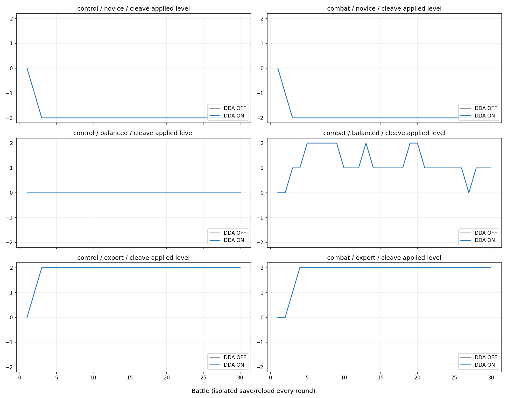
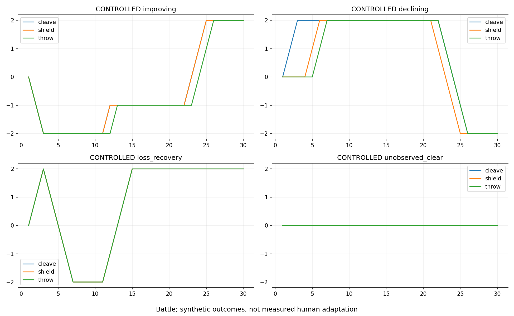

# DDA 적응·튜토리얼 Cold Start 검증 — 2026-11-18

통합 기준 `969f3e9c59712c3cb38d2d321c68186dfeaa0001`, 작업 브랜치 `feat/dda-adaptation-proficiency-coldstart-20261118`. 시작·종료 전 원격 main `83d9085`, PR50 `be57b0b`, Lab `779352c`, 통합 `969f3e9`를 확인했다. AGENTS/CONTRIBUTING을 읽었고 기존 4개 worktree·미커밋 상태를 보존했다. 실제 DB 설정·인증키·개인 저장/운영 CloudQueue는 읽지 않았다. 독립 `/workspace/dda-adaptation`에서 실행했다.

기존 완료: PR50의 튜토리얼/최초·재평가/UUID/저장·복원/궁극기와 Lab/UI/선택·수신 진단, 이전 통합 QA. 이번 신규: 실제 적용값/모델 결정 추적, 빈 DB 튜토리얼 prior, 그룹 fallback, 보호된 신규 telemetry 경로/SQL, 튜토리얼 F8·시간 분리, 추가 시나리오 및 실험 증거. 기존 Reward/Choose 임계값·공격 보정·밸런스·씬/Prefab/아트/기존 DB 스키마는 바꾸지 않았다.

## 1. -1~-2에 머물 수 있는 실제 원인

사람이 잘했다고 느낀 것과 **패턴별 유효 관측 성공률**은 다르다. 실제 `PlayerHit` 경로에서 위협 판정된 패링/대시 회피/피격이 기회에 포함되고, 일반 피격 무적은 ignored다. 사거리 밖 회피·보스 빠른 처치·공격하지 않은 패턴은 유효 성공 관측이 아닐 수 있다. 조작 횟수/보스 클리어율을 패턴 성공률로 간주하지 않는다.

- 3연패 이상이면 성공률과 무관하게 한 단계 하향(최저 -2). 100% 대응+패배 주입으로 재현했다.
- 기억 성공률 <45%이면 하향, >90%이면 상향, 사이에서는 이웃 3개 이하 arm의 실제 LinUCB 점수를 비교한다. 이전 패턴 성공률은 최신 전투와 .5 EMA, 첫 관측은 실측값 그대로다.
- 잘 학습된 -2 arm, 기억 성공률 85%에서는 쉬운 arm이 계속 이길 수 있다. 보상은 70% 근접을 선호하며 성공률만 단조롭게 보상하지 않는다. 85%는 강제 상향 기준 >90%에 해당하지 않는다. 이 현상은 재현 가능한 **정책/모델 목적의 한계**이지 저장 실패의 증거가 아니다.
- DDA OFF는 0 및 학습 제외. 포기는 학습·연패 제외. 관측이 전혀 없으면 학습·판 수·연패가 증가하지 않는다. 관측 1회는 극단적인 성공률이 되어 변동성이 크다.
- 배정 레벨과 현재 공격 적용값, 다음 판 예측은 별개다. 기존 열만 보면 혼동할 수 있어 실제 BeginPattern 스냅샷을 추가했다.

사용자의 실제 저장/플레이 로그는 접근하지 않았다. 따라서 위 원인 중 **사용자 개인에게 무엇이 발생했는지는 확정하지 않는다.**

## 2. 재현한 문제와 수정

1. 유효 expert 튜토리얼·DB 없음에도 첫 만남 0: 신규 승인 범위의 보수적 prior로 연결했다. 개인 학습 데이터는 만들지 않는다.
2. `observations>0, battles=0`인 불일치 기억이 첫 만남 분기로 덮일 가능성: 패턴 관측이 있으면 개인 경로를 선택하는 방어를 추가했다. 실제 사용자의 save가 이 상태였다는 주장은 아니다.
3. 개인 기록이 생긴 후 미관측 패턴의 문맥이 늦은 공동 통계로 바뀔 수 있던 경로: 이후 개인 기억을 우선한다. 활성 전투 배정은 그대로이고 revision은 다음 예측만 갱신한다.
4. F8 현재 수치의 근거 부족: 실제 공격 객체 level/선딜/피해/쿨다운을 보관하고 CSV와 같은 값을 표시한다. Result에서는 이전 공격을 현재로 표시하지 않는다.
5. 설명 시간이 기존 조기 return으로 계측되지 않던 부분: unscaled delta로 설명/정지/active를 분리했다. 기존 수행시간 점수 비중은 유지한다.
6. 그룹 수신 coroutine 취소 시 '수신 중' 잔류: finally에서 수신 중단으로 바꾼다.

개인 Reward/alpha/90%·45%/연패/한 단계 제한은 수정하지 않았다. 대안은 최소 유효 관측수·높은 성공률 지속시 탐색·보상 목표 재검토지만 이는 인간 플레이 비교가 필요한 별도 정책 제안이다.

## 3. 30회 장기 실험

실제 제품 C# + UnityShim + .NET8. seed17, 아라쿠스, 매 전투 저장→로드→모델/다음 배정 동일 확인. **17설정×30전투×ON/OFF×동일 조건 재실행 = 2,040전투**(통제 1,320, 실제 Update 루프 720). 반복실패 combat은 novice 입력과 같아 독립적인 강제 패배 실험이 아니다. 17/17 재실행의 전체 결과 fingerprint 일치.

아래 수치는 ON의 첫 30회다. 대응률=(패링+회피)/유효 기회, 마지막 레벨은 cleave의 **다음 전투** 값이다. 통제는 입력 생성이며 사람이 적응하거나 목표에 수렴한 증거가 아니다.

| 모드/입력 | 기회 | 관측 대응률 | 실제 학습 update | cleave 다음 Lv |
|---|---:|---:|---:|---:|
| 통제 초보 | 5400 | 30.6% | 270 | -2 |
| 통제 일반 | 5400 | 70.0% | 270 | 0 |
| 통제 숙련 | 5400 | 94.9% | 270 | +2 |
| 실제 루프 초보 | 603 | 24.2% | 194 | -2 |
| 실제 루프 일반 | 478 | 52.9% | 185 | 0 |
| 실제 루프 숙련 | 545 | 72.1% | 173 | +2 |
| 통제 상승 | 5400 | 65.4% | 270 | +2 |
| 통제 하락 | 5400 | 65.7% | 270 | -2 |
| 통제 반복 패배 | 5400 | 10.1% | 270 | -2 |
| 실제 루프 상승 | 551 | 47.2% | 187 | +1 |
| 실제 루프 하락 | 537 | 47.5% | 182 | -2 |
| 실제 루프 반복실패 입력 | 603 | 24.2% | 194 | -2 |
| 통제 100% | 5400 | 100% | 270 | +2 |
| 통제 97.5% 확률 | 5400 | 97.5% | 270 | +2 |
| 통제 100%+10패→20승 | 5400 | 100% | 270 | +2 |
| 통제 패턴당 1관측 | 270 | 95.9% | 270 | +2 |
| 통제 무관측 클리어 | 0 | 미정의 | 0 | 0 |

실제 숙련 에이전트는 29클리어/1시간초과 포기. 평균 대응률 72.1%지만 패턴·전투 표본 중 60~80% 구간인 비율은 6.7%이고 기회가 1~4회인 패턴도 있다. throw/sweep은 마지막 다음 값 -2다. **평균이 목표 구간이라는 이유로 패턴별 안정 수렴을 입증했다고 볼 수 없다.** 일반 에이전트 평균52.9%, 초보24.2%도 목표 미달이다. 입력 에이전트는 내부 상태를 보는 규칙 기반이며 인간 숙련도의 대체물이 아니다.

기준 `969f3e9`에서 먼저 실행한 stable 6설정(통제/실제×3프로필)과 수정 후 같은 조건을 대조했다. **모든 전투의 stats/레벨 차이 0**. 첫 prior가 없는 기존 조건에서 이 실험의 결과 변화가 없음을 보인다. 모든 튜토리얼/그룹 정책의 인간 적합성까지 보장하지 않는다.

전체 패턴/회차/ON·OFF CSV는 [압축 CSV](DDA_ADAPTATION_20261118_BATTLES.csv.gz), 요약·소스 hash·실행 command·fingerprint는 [실험 JSON](DDA_ADAPTATION_20261118_RESULTS.json), [수정 전후 대조](DDA_ADAPTATION_20261118_BEFORE_AFTER.json). 전체 raw JSON/선택 CSV는 작업 환경 `/workspace/adaptation-results/final-study/<run>/`에 있다. 클론에서는 실행기로 재생성한다.

## 4. LinUCB 학습과 A/b

모델은 제품 `Context/Choose/Update/Reward`를 그대로 실행했다. 개인 후보 점수는 Choose와 동일 helper에서 계산한다. 강제 보호/초기값/OFF는 `candidateScoresUsed=false`로 구분한다. Prepare의 untrained identity 초기화는 Update 학습과 다르다.

실제 루프 숙련 ON: 유효 update173회, 순차 update L2 변화량 합 A=362.1565/b=111.3549. 통제100% ON:270회, A=516.8700/b=186.2544. 이 합은 최종 전체 행렬 norm이 아니다. 모든 OFF의 before/after 모델이 같았고, 무관측 시나리오는 ON도 A/b 변화0이다. 각각의 aBefore/aAfter/bBefore/bAfter hash와 context·후보 점수·실제 reward·skip 원인은 JSON/learning.csv에 있다. 실제 게임은 `DdaLearning/<battle UUID>.json`, 적용 공격은 `DdaApplied/<session>.csv`에 진단한다. 로그 실패가 진행 저장 실패로 바뀌지 않는다.

## 5. 튜토리얼 계산과 시간

실제 `TutorialAssessment`와 기존 규칙: 패링35%+회피35%+조작20%+active 수행시간10%, 참조120초. score<.40 초보, 충분한 증거+score≥.85 숙련, 나머지 일반. novice/normal/expert를 사용하며 Lab 입력 balanced는 adapter에서만 normal로 대응한다. LinUCB가 분류를 학습했다는 주장이 아니다.

실제 TutorialSession 이벤트로 각30회: 실패8~10회 초보30, 실패1회 일반30, 충분한 패링·성공 숙련30. **설계한 입력 fixture의 분리 검증**이며 실제 사용자 등급 비율/정확도 검증이 아니다. 완벽한 패링1/회피1만 있으면 normal/confidence<.5로 보수 처리됨도 확인했다. 숙련자를 가릴 가능성은 남으며 반복 실습 기회/증거 수 기준은 플레이테스트 후 합의해야 한다.

`activeDurationSeconds`, `elapsedDurationSeconds`, `explanationSeconds`, `pausedSeconds`를 분리했다. active만 점수에 포함한다. 설명300초·정지120초를 늘려도 점수 같음, active를 늘리면 시간 점수 감소를 검증했다. elapsed는 엔진이 Tick한 unscaled 경과이며 앱이 종료/비활성으로 업데이트되지 않은 벽시계 시간은 아니다. 구버전 평가의 새 필드0은 미측정이다. 기존 최초 평가를 새 규칙으로 다시 채점하지 않는다. 재평가/스킵/중단은 최초를 덮지 않으며 튜토리얼은 보상·일반 전투·개인 학습/그룹 보스전 통계에서 제외된다.

## 6. 실제 DB 데이터가 없을 때

운영 DB의 존재/건수는 확인하지 않았다. **빈 fixture**에서 schema1·완료·valid·최초·미스킵·유효 raw 지표·active>0 평가를 검증한다. confidence≥.5이면 잠정 v1 novice -1 / normal0 / expert+1, 부족하면0. 미평가/스킵/잘못된 평가는 기존0. 첫 만남 보호 [-1,+1] 안의 보수적 가설이며 검증된 최적 초기값이 아니다. 개인 모델 Update나 가짜 전투를 만들지 않는다.

즉시 fallback을 선택했다. 첫 전투를 기다리거나 자동 재시도·영속 DB 캐시를 추가하지 않았다. 수신 지연/실패도 플레이 가능하고 활성 전투 배정은 불변이다. 미관측 클리어에서는 개인 근거가 안 생겨 다음에도 초기 경로를 사용한다.

## 7. 충분한 그룹 DB

패턴마다 **개인 기록(해당 보스 학습 판수>0 또는 해당 패턴 observations>0) → 유효 최초 그룹 DB → 전체 DB → 유효 튜토리얼 → 기본0**. 개인 기록 뒤에는 cold prior가 덮지 않는다. OFF0은 모든 경로보다 우선한다.

그룹: 같은 그룹·20기회·3 익명 capability 소유자·유한 success[0,1] 이상. 전체:20기회·1프로필 이상. DB 추천은 [-1,+1]로 제한. 그룹 부족/다른 그룹/패턴 누락은 개별 fallback. 최초 평가의 confidence<.5는 그룹 선택 증거로 사용하지 않는다. 이것은 명시된 보수적 표본 기준이며 통계적 신뢰구간 보장은 아니다. 메모리 fixture는 `(메모리/모의)`로 이유에 표시하고 HTTP 수신과 구분한다. 표본 수/익명 프로필 수를 부풀리지 않는다.

## 8. 저장·조회·집계 구현

실제 `SaveStore` 별도 outbox/key/receipt와 `CloudSync` RPC 전송·그룹 view 수신을 구현했다. 신규 전송 기본 OFF, 신규 migration 운영 미적용. 기존 SaveData/CloudQueue 소유권/원본 UUID reset/restore 보존. raw는 공개 조회하지 않고 억제 집계만 조회한다. 평가→전투 순서, 실패/409/false 보존, true 응답만 ack, 동일 이벤트 멱등, key 분실 시 보존을 테스트했다.

공개 UUID만으로 보안을 주장하지 않는다. 무작위 profile capability가 소유권 namespace를 정하며 원시 테이블은 anon/authenticated 직접 권한이 없다. client honesty/anti-cheat/실제 한 사람 판별은 해결하지 않는다. 다른 PC로 save만 복사하면 원래 key가 따라오지 않는다. 상세 [보안·마이그레이션 절차](../DB/PROFICIENCY_MIGRATION_20261118.md)와 [신규 SQL](../DB/migrations/20261118_proficiency.sql)을 읽고 staging에서 검토해야 한다.

그룹 집계는 당시 연결된 **valid 최초 평가·confidence≥.5·중립 level0** 보스전만 사용한다. 과거 null 링크는 소급 분류하지 않는다. 편향 혼합을 줄이는 대신 그룹 데이터가 늦게 쌓일 수 있다. 실제 Supabase/PostgREST 적용 및 공개 REST 권한은 미검증이다.

## 9. F8과 변경 파일

- `GameServices/GameData`: 실제 선택·학습 trace, 초기 우선순위·증거 검사, 그룹 cache/revision.
- `BossPatternSystem/TowerGame/SaveStore`: 실제 BeginPattern 적용 수치, 현재/결과 구분, 전투 trace·CSV 및 보호 telemetry.
- `TutorialSession/TowerGame.Tutorial`: 실제 임시 점수 preview, 시간 분리, 최초/재평가·저장 상태.
- `DdaPanel/DdaHistoryGraph/GameUI/NativeGameUI`: 현재 공격 적용 Lv/보정, 이번 배정 및 다음 예상 구분, 그룹/수신/근거, 튜토리얼 실시간 관측·점수·시간·로컬/전송 상태. F9로 관측 펼침. 패널 포인터는 튜토리얼 클릭 공격 입력에서 제외하고 종료 요약이 메뉴 위에 열린 동안 메뉴 입력을 막는다.
- `CloudSync`: opt-in RPC와 그룹 수신. 실패/취소를 구분한다.
- `Tools/DdaLab`: 통제 시나리오5개 추가, actual trace JSON/learning CSV export. 기존 그래프/비교/재실행 재사용.

실제 수치 read model/적용 CSV 일치, 테이블 변형 뒤 현재 공격 snapshot 유지, Result stale 공격 제외를 headless로 확인했다. **F8 Unity UI 코드는 구현 상태이며 화면 렌더/실제 입력 검증 완료가 아니다.** 패널 기본 위치를 가이드/종료 버튼 아래로 옮겼으나 작은 화면의 겹침·스크롤·클리핑은 Unity에서 확인해야 한다.

## 10. PASS/FAIL와 남은 위험

| 실제 실행 | 최종 결과 |
|---|---|
| 기존 회귀 9 suites | 9/9 (실패한 logic/size만 수정 후 재실행; 원래 FAIL 기록 보존) |
| Headless / 궁극기 / size | 738 / 37 / 953 PASS |
| DDA 학습 / 빈도 / 손상 방어 / Phanes | 269 / 185 / 31 / 3188 PASS |
| 튜토리얼 상태 / 저장 / 실게임-DDA / 기존 queue | 30 / 7 / 24 / 24 PASS |
| 신규 적응·fallback·시간·평가 / 보호 HTTP | 155 / 28 PASS |
| 기존 실제 Cold receive→Prepare | 23 PASS |
| PostgreSQL 격리 SQL/RLS/FK/집계 | 39 PASS |
| Lab API/adapter / Chromium UI | 46 PASS / UI_PASS |
| 장기 실험·저장 복원·반복 | 2040전투 / 17설정 동일 |
| 수정 전후 기존 stable6설정 | 모든 전투 stats 차이0 |

실패 분류와 처리:

- 초기 신규 adaptation 컴파일 FAIL: HEADLESS에 없는 UI mouse 함수 참조(**이번 신규 회귀**). 조건부 bridge를 추가했고155검사 통과.
- 기존 Cold 테스트의 `공동 통계` 문자열 및 Headless의 기본 이유 완전 일치(**낡은 검사 가정**). 새 출처/설명으로 갱신. 후자는 무학습 상태 전체 serialization 불변 검사를 추가해 목적을 강화했다.
- 기존 tutorial-dda의 '모든 미관측 패턴에 튜토리얼 영향 없음'(**이번 승인된 정책과 충돌하는 검사 가정**). 충분한 전체 DB가 있는 해당 패턴 우선순위 검사는 유지, 누락 패턴은 신규 fallback 검사로 검증.
- 기존 아트 source_unchanged2개: exact hash scope 계약으로 실제 제품 변경 범위만 인정하고 예상치 않은 변경은 계속 FAIL. [신규 계약](../../Tests/Contracts/ADAPTATION_SCOPE_20261118.json). 구 계약을 덮거나 검사 삭제하지 않았다. mutation/커밋 후 우회 방지 테스트도 통과.
- 첫 SQL harness의 mount guard: 공식 이미지가 자동 생성한 전용 data volume을 거부한 **실행기 환경 가정**. network none/host mount 없음/port 없음 및 자동 PG volume 검사를 유지해 수정 후39검사.
- main float 정확 비교: 이전 통합 보고서에서 main83과 동일하게 원인 분리 및 허용오차 검사 보강 완료된 범위다. 이번 main을 다시 실행했다고 주장하지 않는다. 현재 동일 main83임을 확인했고 후보738 PASS.

[최종 회귀](DdaAdaptationEvidence/final-regression.json), [초기 FAIL](DdaAdaptationEvidence/initial-regression.json), 해당 폴더의 실제 로그/manifest에 근거를 남겼다. 최종 실패를 숨기거나 무조건 PASS로 처리하지 않았다. 후보의 Unity API 컴파일과 인간 적응은 자동검증으로 입증되지 않았다.

## 11. 집 PC·Unity·Windows·운영 DB 확인

Unity6000.4.0f1은 이 환경에서 찾지 못했다. Game View/실제 F8·F9/오디오 청음/Windows 빌드/실제 Supabase는 **실행하지 않았다**. 아래는 테스트 복사본에서 수행한다.

1. Unity console 컴파일 오류0 확인. 새 empty save로 초보/일반/숙련 완료 및 스킵, DB 설정 없이 첫 배정 -1/0/+1/0 확인(신뢰 부족은0).
2. 튜토리얼 F8을 설명/일시정지/실습/종료에 열어 raw·점수·active/elapsed·저장/전송 상태가 즉시 바뀌는지 확인. F8 자체가 공격·다음 단계로 처리되지 않는지 확인.
3. 1920×1080 및 낮은 해상도/창 모드에서 가이드·HUD·종료 버튼·F8/F9·resize/scroll 겹침과 텍스트 잘림 확인. 패널 위 클릭이 공격으로 들어가지 않는지 확인.
4. 일반 보스 F8의 현재 Lv/선딜/피해/쿨다운을 실제 attack와 DdaApplied CSV, 끝난 뒤 DdaLearning JSON·다음 예측과 대조. late receive는 현재 배정이 아닌 다음 예측에만 반영되는지 확인.
5. 테스트용 저장에서 초기화→새 UUID→이전 프로필 복원, first/replay 보존, 큐·key 소유자 유지. key 분실 시 진행은 플레이 가능하고 telemetry는 보존/실패하는지 확인.
6. Q/W/E 게이지·R 감쇠/검 강화·아라쿠스 특수 궁극기, 모든 보스 동작과 세이브/로드 회귀. 인간 플레이로 sparse/고대응·낮은 난이도 로그를 확보한다.
7. 보스별 BGM 전환/일시정지·복귀/궁극기 음향을 청음하고 Windows 빌드 smoke. 이번에 음원 생성·오디오 변경·품질 판정을 하지 않았다.
8. DB 활성화는 별도 staging SQL/RLS/PostgREST 절차를 마친 뒤. 운영 적용은 이번에 수행하지 않는다. 실제 프로덕션 데이터가 충분하다고 가정하지 않는다.

시뮬레이터 실행: `python Tools/DdaLab/lab.py --dotnet <dotnet 경로> --data-dir <새 결과 폴더>`, 로컬 `http://127.0.0.1:8765`. 이 Cloud 작업에서는8768을 사용했다. Cloud localhost를 집 PC에서 그대로 여는 주소로 안내하지 않는다. 상세 [사용법](../../Tools/DdaLab/README.md).

## 12. 브랜치·PR·동결 우선순위

브랜치: `feat/dda-adaptation-proficiency-coldstart-20261118`. main/PR50/Lab/기존 통합 브랜치는 수정·병합·강제 Push하지 않는다. 신규 후보는 이전 통합을 포함하므로 향후 main 병합 순서에 따라 base를 최신화하고 공동 파일을 의미 단위로 검토해야 한다.

팀원 충돌 위험은 `CloudSync`, `GameServices/GameData`, `TowerGame(.Tutorial)`, `SaveStore`, `TutorialSession`, F8/UI 및 관련 테스트에 높다. 씬/Prefab/아트는 변경하지 않았다. 기존 업로드 큐와 UUID 소유권 경로는 유지하고 신규 경로를 별도로 추가했지만 공동 파일 병합은 자동으로 안전하다고 볼 수 없다.

11/20 전 우선순위:

1. **필수** Unity 실제 컴파일·튜토리얼 F8/입력/화면·전투/save/궁극기 smoke 및 Windows 빌드. 자동검증 PASS만으로 발표 빌드 승인하지 않는다.
2. **필수** 인간 고대응인데 -2가 유지되는 실제 로그를 수집해 low-observation/EMA/연패/LinUCB 원인을 확인. 85% 쉬운 arm 유지가 원치 않는 정책인지 결정하되 동결 직전 reward/threshold 일괄 변경은 피한다.
3. 튜토리얼 -1/0/+1와 confidence/20기회·3소유자 기준은 보수적 v1 가설로 팀 합의/플레이테스트. 미합의 시 개인 LinUCB를 재설계하지 말고 첫 prior만 별도 검토한다.
4. 신규 telemetry는 기본 OFF를 유지하고 SQL 보안·staging·key 백업/Windows ACL·익명 데이터 운영 방침 승인 후 활성화한다. 그룹 DB가 없어도 로컬 prior로 발표 가능하다.
5. 발표 전 보스별 BGM/일시정지 청음·11/23 시연 흐름을 실제 Windows에서 확인한다.

제품/테스트 커밋 `24e6a2c`, Lab 커밋 `166fe3f`. 실험은 커밋 전 동일 제품 소스에서 실행하여 manifest의 source_commit은 기준969f3e9로 표시된다. 실제 실행 소스의 SHA256을 함께 기록했고 최종 제품과 exact scope hash가 일치한다. Git Push/PR 결과는 아래 전달 기록에 추가한다.
