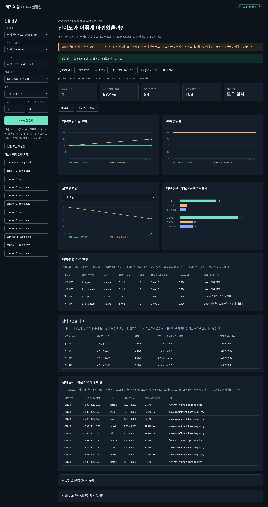

# DDA 실험실·Cold Start·F8 잔여 개발 — 2026-11-17 KST

## 기존 작업 / 이번 신규 작업

- 원격 main을 다시 fetch했으며 기준은 `83d9085fb44a6218e721b68b16d620c4669f5d95`이다.
- 원래 work 브랜치와 기존 `test/dda-simulator-coldstart-20261117` worktree는 깨끗했고 그대로 보존했다.
- 새 worktree `/workspace/dda-lab`, 브랜치 `feat/dda-lab-diagnostics-20261117`를 main에서 생성했다.
- 기존 감사 작업 `c21e182`, `5a101c4`를 각각 `6eb86ed`, `37c5925`로 충돌 없이 재사용했다. 기존 269검사/240전투/선택 2,968결정/64산출물 검증을 새 개발로 세지 않는다.
- 이번 신규 구현은 조작 가능한 오프라인 실험실, 실제 수신-Prepare 통합 검사, Cold Start/F8 진단과 오류 복구, 테스트 전용 튜토리얼 계약, 오디오 하네스 복구다.

## 구현과 파일

| 목적 | 파일 / 결과 |
|---|---|
| 실제 C# 실험 실행 | `Tools/DdaLab/Experiment.cs`: 전투·합성 학습·조건 선택을 분리, 5보스·3프로필·상승/하락/반복실패·시드·1~100회·ON/OFF |
| 로컬 UI/API/CLI | `Tools/DdaLab/lab.py`, `index.html`: 실제 완료 결과만 표시, SVG 그래프·필터·조건별 비교·JSON/CSV·이전 결과 비교·재실행·소스별 빌드 캐시·디스크 실행목록 복원 |
| 사용 안내 | `Tools/DdaLab/README.md`, 예제 config 3개 |
| 수신/배정 진단 | `GameServices.cs`: HTTP 수신 상태·메모리 원본·revision·성공 시각, Prepare 시점/패턴별 근거 스냅샷. 정상 입력의 Decide/Choose/Update 정책은 그대로 |
| 오류 처리 | `CloudSync.cs`: 수신 시작/성공/실패/중단 계측, 잘못된 행이 캐시를 지우지 않도록 검증, 종료/IO 오류에서도 sending 해제 |
| F8 | `DdaPanel.cs`: 현재 수신과 당시 배정 구분, 패턴별 원본 근거, 수신 revision으로 다음판 캐시 무효화, 기존 리셋/설정/결과 변경 무효화 유지 |
| 통합/계약 검사 | `ColdStartIntegrationTests.cs`, `run-cold-start-integration.py`, `CloudSyncStatus/Stubs.cs`, `Contracts/TutorialAssessmentCandidate.cs` |
| 실험실 회귀 | `test-dda-lab.py`, `test-dda-lab-ui.py` |
| 오디오 검사 | `BossAudioLifecycle/Stubs.cs` 44,100Hz, `run-audio-lifecycle.py`; 음원·제품 Soundscape 변경 없음 |

커밋: `87f7f86` 실험실 / `701f87d` 진단·F8·계약 / `21b2a31` 오디오 하네스.
씬·Prefab·아트·전투 입력/판정·보스 밸런스·BanditModel 정책·SaveData 필드·DB 스키마는 변경하지 않았다.
API/대시보드는 loopback에서만 동작하며 외부 shell 명령·임의 소스/파일 경로를 입력받지 않는다.

## 사용법

.NET 8 SDK와 Python 3.10 이상이 설치된 PC에서 저장소 루트 기준:

```bash
python Tools/DdaLab/lab.py --data-dir ./TestResults/DdaLab
```

실행한 PC의 브라우저에서 `http://127.0.0.1:8765`를 연다. Windows는 `py`도 가능하다.
Cloud 실행기의 경우 `--dotnet /workspace/.cloud-setup/dotnet/dotnet`을 추가한다.
CLI 실행은 `--config Tools/DdaLab/example-control.json`을 추가한다.
[전체 사용 안내](../../Tools/DdaLab/README.md).



통제 학습은 인위적 결과로 실제 C# 학습을 실행하며, 자연 전투는 실제 Update와 rule-agent 입력이다.
선택 probe는 실제 selector를 직접 호출하며 자연스러운 전투 빈도가 아니다.
화면에 종류를 명시하며 다른 모드의 비교도 주의 문구를 표시한다.
공격 시작과 가중 선택 decision도 구분한다. 강제 Step/Rage 시작은 별도 프레임 표본으로 집계한다.
거리·페이즈는 전투 프레임 종료 표본이므로 정확한 gate 시점이라고 주장하지 않는다.
reward 계산값과 실제 학습 적용은 다르며 OFF·포기·선택 probe는 학습하지 않는다.

## 실제 실행 결과

실행 환경: .NET 8.0.428 / net8.0 / Python 3 / Chromium headless.
실험 시드 기본 17, 변경/기존 감사 42 포함. 각 실험 회차 seed는 기본 + 회차 - 1.
모든 C# 테스트는 소스 허용 목록과 임시 저장 경로를 사용했다. 실제 DB 설정·개인 save·기존 큐·인증정보를 읽거나 변경하지 않았다.
.NET mutex 제한 때문에 지원되는 command escalation을 사용했으며 TLS/서명 검증을 끄지 않았다.

| 실행 명령 (저장소 루트) | 결과 / 실제 범위 |
|---|---|
| `python Tests/test-dda-lab.py --dotnet <SDK>` | 46 PASS. 3모드, 5보스 실제 Update, ON/OFF 입력·A/b 갱신/미갱신, 저장/다음배정 복원, 시드 변경/동일, 상승/하락/반복실패, 공격 시작, 히스토리 복원, 잘못된 config 거절 |
| `python Tests/test-dda-lab-ui.py --chromium /usr/bin/chromium --output <경로>` | 실제 C# 실행/재실행, 그래프, JSON 다운로드·비교 불러오기, 실제 전투 모드, 조건 표, 1440/390px 화면, 잘못된 POST 403/400, JS 오류 없음 |
| `python Tests/run-cold-start-integration.py --dotnet <SDK>` | 23 PASS. **실제 CloudSync→실제 CommunityStats→실제 Prepare**. HTTP/Unity/카드 전투력은 double; 수신 코루틴을 수동 중단/재개/취소. 실제 네트워크/Unity scheduler 아님 |
| `python Tests/run-dda-system-audit.py --dotnet <SDK> --output <새 경로>` | 학습 269 PASS×2, 전투 240회×2, 선택 2,968결정×2, 빈도185/robustness31/기존 모의수신16 통과, 산출물64/64 동일 |
| 이전 감사 산출물과 이번 진단 변경 후 정책 산출물 비교 | 64/64 동일. 합성 CSV·모델60개 JSON·선택/Catalog·전투 CSV. 정상 입력의 기존 정책 보존 근거이며 모든 인간 플레이의 동등성 증명은 아님 |
| `python Tests/run-final-integration.py --dotnet <SDK> --output <새 경로>` | **7 suite PASS / 2 suite FAIL**. 아래 실제 실패를 숨기거나 xfail 처리하지 않았다 |
| `python Tests/run-audio-lifecycle.py --dotnet <SDK>` | 27 PASS. 실제 Soundscape/CombatSoundDesign + AudioSource/Wave doubles; 실제 믹서·DSP·청음 아님 |
| `python Tests/verify_boss_music.py`, `verify_lobby_music.py`, `verify_boss_sfx.py` | 모두 PASS. 기존 음원 해시/PCM/연결/효과음 결정성. 효과음 재생성 비교는 임시 경로에서 하며 게임 음원을 교체하지 않음 |

기존 통합의 실패 두 개는 다음과 같다.

- room-resources: `206 PASS / 1 FAIL`, `combat_DDA_DB_input_camera_scene_prefab_settings_unchanged`.
- size-resources: `86 PASS / 1 FAIL`, `DDA_DB_save_player_rules_source_unchanged`.

이는 아트 전용 변경에서 DDA/DB 코드가 바이트 동일함을 요구하는 검사다. 이번 사용자 요청으로 허용된 GameServices/CloudSync/DdaPanel 진단 변경을 잡았다.
실제 전투·학습·기록·패널 계산 검사는 통과했지만 **전체 통합 PASS라고 보고하지 않는다**.
해당 보호 검사는 수정·삭제하지 않았다. main 리뷰에서 변경 범위와 실제 diff를 함께 판단해야 한다.

새 하네스 의존 누락(CardStack) 1건을 스텁으로 보완했고, UI 파일 읽기 완료 전에 단언하던 검사 1건은 완료 대기 후 재실행했다.
과거 오디오 실패는 스텁 샘플레이트 1000이 실제 Render 허용 8000~192000 밖이었던 원인이다. 유효 44100으로 복구했으며 단언은 유지했다.

세부 로그/JSON/CSV는 현재 환경 `/workspace/dda-lab-results`에 있다.
최종 감사는 `release-audit/audit.json`, 이전 본체 검사는 `audit-final/audit.json`, 통합은 `integration-final/final-suite-summary.json`이다.
대용량 원시 CSV는 저장소에 추가하지 않는다. 제품/UI 결과에는 실행 시점 커밋과 소스별 SHA-256가 들어 있다.

## Cold Start·F8의 남은 경계

첫 전투 강제 대기·영속 캐시·TTL·주기 retry/backoff는 **도입하지 않았다**.
늦은 수신은 진행 중 레벨/근거 스냅샷을 바꾸지 않으며, revision 변경으로 결과 화면 다음판 예측만 다시 계산한다.
HTTP 수신 성공은 메모리 주입과 구분한다. 잘못된 행/수신 실패는 이전 snapshot/revision/성공 시각을 유지한다.
개인 관측·공동 통계의 기존 우선순위와 첫 만남 -1~+1 제한을 바꾸지 않았다.
숫자적으로 이상한 서버 집계 전체를 수리하거나 새 난이도 정책으로 대체하지 않았다.

F8/F9 스크롤·리사이즈·입력 소비와 CSV는 기존 것을 재사용한다.
화면과 선택 CSV는 기존 동일 evidence 객체를 사용하며, 수신·배정 근거는 진단 스냅샷이다.
F8 행 높이와 header를 늘려 새로운 텍스트 영역을 확보했다. **실제 Unity의 글꼴·클리핑·스크롤·CSV와 시각적 일치는 미검증**이다.
캐시 key의 수신·설정·초기화·결과 무효화는 실제 helper로 검사했으나 GUI 자체를 실행한 것은 아니다.

승인/합의가 필요한 후보:

1. 첫 전투에 공동 통계 사용이 필수인지 결정. 기본값 즉시 진입 유지 / 명시적 준비 표시 / 제한 대기+fallback을 비교하되 이번에는 대기를 추가하지 않음.
2. 영속 캐시 필요성, 버전·만료·오래된 값 표시·개인 기록 우선순위를 먼저 합의. DB/SaveData에 임의 필드를 추가하지 않음.
3. retry는 기존 다음 SyncAll 트리거만 유지. 새 주기/backoff·최대 횟수·UI 메시지 정책은 담당자 합의 후 별도 구현.
4. 실제 수신 숫자 집계의 유효 범위·누락 행 처리 정책, 숙련도별 DB 집계와 스키마는 별도 합의.

## 튜토리얼 계약 — 테스트 전용

다른 팀원의 튜토리얼 코드·파일은 건드리지 않았다.
`Tests/Contracts/TutorialAssessmentCandidate.cs`에 제안 DTO만 추가했다.

- team-supplied Novice/Balanced/Expert 분류, 패링·회피·피격·기회, 완료 여부·시간·재시도, 평가 버전·시점, 최초/재평가 구분.
- 카운터 합계·음수·비유한 시간·누락 버전/완료 분류 검증. 분류 점수식·임계값 없음.
- DTO 검증은 모델을 학습하지 않으며 `ExcludedFromDdaLearning`은 **계약 의도**다. 아직 존재하지 않는 튜토리얼 런타임 경로의 학습 제외가 구현됐다는 뜻이 아니다.
- 다음 연결 후보: 유효 개인 기억 → 합의된 숙련도 공동 통계 → 전체 공동 통계 → 기본값. 이는 제안이며 현재 정책을 대체하지 않음.
- DB 수신 실패 시 기본/개인 fallback 유지, 기존 세이브에는 필드를 추가하지 않는다. 지속 강제 보정과 첫 초기값만 쓰는 정책은 따로 승인받아야 한다.

## BGM·오디오 확인 범위

현재 실제 로비/5보스 manifest는 **Kevin MacLeod / CC BY 4.0** 곡을 가리킨다. AI 제작 BGM을 새로 생성/적용했다고 주장하지 않는다.
현재 경로는 로비 recording, 보스별 loop, 누락 시 battle/carrier 합성 fallback이다.
lobby 유지, boss 변경 전 fade/이전 clip 정리, phase2 볼륨, ESC Pause/UnPause cursor 유지, 로비 복귀, 누락 효과음 fallback을 스텁으로 검사했다.
청음하지 않았으며 음악 품질·체감 자연스러움·Unity 실제 DSP/프레임 타이밍은 평가하지 않았다.

## 11월 18일 집 PC 체크리스트

1. 브랜치를 새 경로에 받고 .NET 8 SDK/Python으로 실험실 실행. 초보/일반/숙련, 상승/하락, ON/OFF, seed 17/42를 바꿔 JSON/CSV 저장과 동일 조건 재실행을 확인한다.
2. Unity **6000.4.0f1**과 유효 라이선스, Windows Build Support를 준비한다.
3. **개인 저장/CloudQueue/실제 DB 설정을 사용하지 않는 독립 복사본**을 만든다. Assets 복사 시 `supabase.json`을 제외하고, DB 설정을 열거나 출력하지 않는다. Packages/ProjectSettings는 테스트 복사본에만 복사한다.
4. 수동 Play 전에 별도 테스트 OS 사용자 또는 복사본의 테스트 전용 Company/Product 설정으로 persistentDataPath/PlayerPrefs가 개인 데이터와 분리됐는지 확인한다. 원본 설정·기존 save/CloudQueue를 지우거나 옮기지 않는다.
5. `TowerProduction` 컴파일·Play. F8/F9, 창 크기/스크롤, 긴 공동 통계 메시지·배정 근거 잘림, 전투 입력 소비, 결과 후 DDA OFF/ON·초기화 갱신을 확인한다.
6. 실제 DB 없이 수신 지연/실패/다음 Prepare는 모의 통합 검사로 확인한다. 이번에는 실제 Supabase 접속을 하지 않는다.
7. 로비→각 보스→phase2→ESC/설정/도움말 pause/resume→포기/결과→로비의 음악, 재생 위치 유지·전환 클릭음·볼륨·루프 이음·누락 fallback을 청음한다. 품질 판정은 이때 별도로 기록한다.
8. 독립 출력 폴더에 Windows 빌드를 만들고 수동 플레이/실제 F8/오디오를 확인한다. `-tower...` 자동검증 인자는 F8과 화면 입력을 억제하므로 수동 GUI 검증 대용으로 쓰지 않는다.
9. 화면 레벨·선택 probability와 해당 독립 저장 루트의 DdaDecisions CSV를 대조한다. UI 스크린샷·Unity 로그·빌드 결과를 기록한다.

## 11월 20일 기능 동결 / 충돌

**동결 전 필수:** Unity API 컴파일·F8 화면·Windows·청음 검증, 첫 판 fallback 요구 확정, 튜토리얼 계약/학습 제외 책임자 합의,
실제 변경 diff와 아트 범위 보호 검사 두 FAIL의 리뷰, Draft PR 리뷰와 GitHub 필수 체크 확인.

**현재 요구에 없다면 동결 이후:** 영속 캐시/TTL·주기 retry·숙련도 DB 스키마·인간 플레이 적응 효과 실증·동기 CSV 성능 최적화.

팀원 접점: GameServices(튜토리얼/DDA), CloudSync(DB 담당), DdaPanel(F8), Tests/CloudSyncStatus(검증).
TowerGame/BossPatternSystem·씬·Prefab·아트·Soundscape 제품 코드는 이번에 변경하지 않았다.
원격의 미공개 작업/담당자별 브랜치까지 확인한 것은 아니므로 리뷰 시 위 세 제품 파일의 최신 팀원 변경을 재확인해야 한다.
main 직접 push·병합, 환경 게시, 실제 DB 쓰기/스키마 변경은 하지 않았다.

## 원격 전달 상태

`feat/dda-lab-diagnostics-20261117` Push에 성공했다. 기능/진단/오디오/문서를 목적별 커밋으로 구분했다.
`gh pr create --draft`는 `Post https://api.github.com/graphql: Forbidden`으로 실패했다.
PR 번호는 생성 확인되지 않았으며, API 권한이나 main 병합 권한을 추정하지 않았다.

- 비교: https://github.com/seojb1204/TeamRedBull2/compare/main...feat/dda-lab-diagnostics-20261117
- 준비한 Draft 본문: [DDA_LAB_DRAFT_PR.md](DDA_LAB_DRAFT_PR.md)
- 최종 확인한 원격 main은 여전히 `83d9085`이며 세 worktree 모두 미커밋 변경이 없다.
