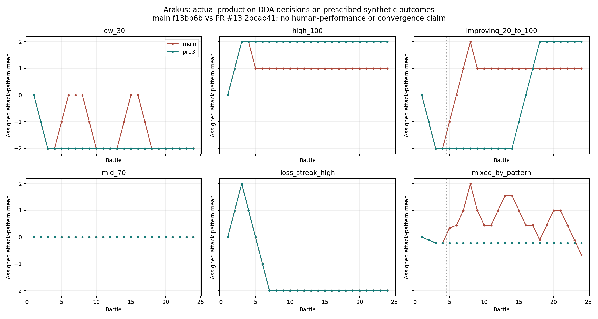
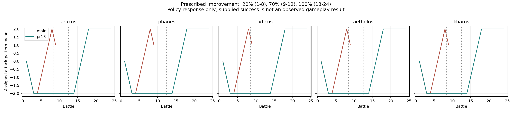
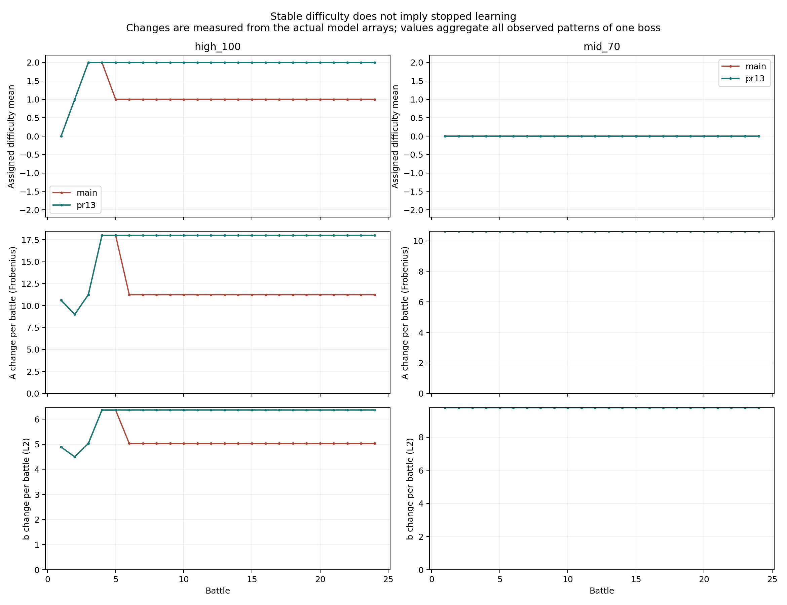

# LinUCB·DDA 학습 검증 보고서

검증일: 2026-11-07(KST). Unity 프로젝트 기준 버전: 6000.4.0f1.
검증 브랜치: `test/dda-linucb-verification`. 공통 코드·씬·Prefab·기존 테스트는 변경하지 않았다.

## 1. 결론

**실제 소스를 실행한 결과 A·b 갱신과 다음 전투의 모델 사용은 확인했다. main의 5판 이후 문제는
학습 호출 중단으로 재현되지 않았으며, 일부 입력에서 선택 정책의 고착/부적절한 방향으로 재현됐다.**
PR #13은 극단 성공률에 대한 지속 규칙 보정으로 이 사례를 해결한다. LinUCB 수학 자체를 고친 것은 아니다.

| 구분 | main | PR #13 |
|---|---|---|
| 분석 커밋 | `f13bb6bd25f469e38acce05eceb712712dc30c3f` | `2bcab4154ae534ba21befc08b5ce4c0d40741329` |
| 신규 검사 | **219 PASS / 29 FAIL** | **248 PASS / 0 FAIL** |
| 추가 관찰 항목 | 3 OBSERVED | 3 OBSERVED |
| 수정하지 않은 기존 검사 | 119 PASS | 126 PASS |
| 기본 반복 세션 | 1,320 | 1,320 |
| 패턴 CSV 행 | 9,768 | 9,768 |
| 동일 입력 재실행 | CSV·검사·모델 57개 파일 바이트 일치 | CSV·검사·모델 57개 파일 바이트 일치 |

PR #13 커밋은 검사 시점 main의 조상이 아니다. 따라서 두 결과를 별도 표기한다.
GitHub API가 차단되어 PR의 현재 Open/Merged UI 상태를 조회하지는 못했지만, **위 PR head의 코드가
검사한 main에 포함되지 않았음**은 Git으로 확인했다.

29 FAIL은 독립 버그 29개를 뜻하지 않는다. 극단 성공률/실력 개선 반응 27개와 포기·종료 2개로,
같은 요구를 보스/시나리오별로 반복 검사한 수다. `desired_...` 검사는 기대하는 제품 정책을 검사한다.
기존 main의 규칙을 정확히 수행하더라도 기대 정책에 미달하면 FAIL이다. 알고리즘을 고쳐 통과시키지 않았다.

### 구분해야 할 네 가지

| 질문 | 이번 검증에서 확인한 범위 |
|---|---|
| 학습 데이터가 갱신되는가? | PASS. 관측 패턴의 실제 A/b를 rank-one update 식과 대조. 보상 0이면 A만 바뀌는 것도 정상 확인 |
| 갱신 데이터를 다음 결정에 사용하는가? | PASS. 다음 Prepare의 Context, 저장 복원 결과, 실제 Update로 학습시킨 대조 모델의 다른 Arm 선택 확인 |
| 실제 배정 난이도가 바뀌는가? | 입력/정책에 따라 다름. main의 고착/역방향과 PR #13 보정, 상·하한/중간 구간 유지 모두 기록 |
| 플레이어 성공률이 60~80%에 수렴하는가? | **증거 없음 / 검증하지 않음.** 성공률은 실험에서 주입한 입력이며 선택 난이도가 성공률을 바꾸는 환경을 측정하지 않음 |

## 2. 실행 방법과 격리

`Tests/DdaLearningVerificationTests.cs`는 실제 `BanditModel`, `DdaBattleSession`, `SaveStore`,
`TowerGame` 소스를 직접 컴파일하고 호출한다. LinUCB/Choose/Update/Reward를 별도 모의 정책으로 대체하지 않는다.
후처리 Python은 CSV 집계·그림 생성만 하며 Arm을 선택하거나 모델을 학습하지 않는다.

- 실행 환경: Linux, .NET SDK 8.0.427, `HEADLESS`, 기존 `Tests/UnityShim.cs`.
- main은 최신 main에서 분기한 검증 브랜치, PR #13은 detached 임시 작업 트리에서 소스를 읽었다.
- 임시 작업 트리의 파일은 수정하지 않았다. 프로젝트/출력물은 그곳에 생성하지 않았다.
- 소스 허용 목록만 컴파일: `GameData`, `GameServices`, `TowerGame`, `BossCombat`, `BossPatternSystem`,
  `SaveStore`, `LobbyCards`, `AutoRun`, `LobbySmoke`, UnityShim 및 검사 진입점.
- **CloudSync와 StreamingAssets/실제 supabase.json은 읽거나 컴파일하지 않았다.** 원격 통계는
  실제 `CommunityStats.Replace()`에 메모리 객체를 넣어 검사했다. 서버 연결/업로드는 실행하지 않았다.
- 빌드/기존 검사 작업 디렉터리는 매번 새 임시 폴더다. 신규 검사 저장은 별도 GUID 폴더로
  `SaveStore.UseIsolatedRoot()`를 지정하고 종료 시 자기 폴더만 제거한다. 개인 저장/CloudQueue는 사용하지 않는다.
- `verification-manifest.json`, `existing-manifest.json`에 커밋, 사용 소스 SHA-256, 결과 코드를 기록했다.
- 직접 작성한 수식은 Update/점수의 독립적인 **테스트 오라클**에만 쓰였다. 반복 실험의 결정은 실제 Choose가 수행했다.

재현 명령(.NET 8 SDK 필요):

```sh
# main 소스에서 실행. 알려진 정책 실패 때문에 종료코드 1이 정상적으로 보고된다.
python3 Tests/run-dda-learning-verification.py --label main \
  --output Docs/Validation/dda_results/main --dotnet /path/to/dotnet

# PR #13은 별도 detached worktree에 준비하고 그 경로를 전달한다.
python3 Tests/run-dda-learning-verification.py --source /path/to/pr13-worktree --label pr13 \
  --output Docs/Validation/dda_results/pr13 --dotnet /path/to/dotnet

# 수정하지 않은 기존 검사도 각각의 source로 실행한다.
python3 Tests/run-dda-learning-verification.py --suite existing --label main \
  --output Docs/Validation/dda_results/main --dotnet /path/to/dotnet
python3 Tests/run-dda-learning-verification.py --source /path/to/pr13-worktree --suite existing --label pr13 \
  --output Docs/Validation/dda_results/pr13 --dotnet /path/to/dotnet

# matplotlib 필요. 실제 CSV만 읽어 요약과 PNG 생성.
python3 Tests/summarize-dda-learning-verification.py
```

main 결과를 성공으로 바꾸기 위해 종료코드를 무시하지 않았다. 보고용 후처리는 실패 결과도 읽도록 별도로 실행한다.
신규 C#는 문법 검사 오류 0개였고 위 실제 소스 집합의 컴파일/실행도 완료했다.
이는 **Unity API 컴파일, Unity JsonUtility 직렬화, 렌더링 검증이 아니다**. UnityShim의 JSON 구현은
DataContractJsonSerializer다. 기존 테스트의 저장 손상/쓰기 실패 메시지는 해당 실패 주입 검사의 출력이다.

## 3. 현재 구현 구조

관련 위치(커밋별 정확한 파일은 manifests 참조):

- `Assets/Scripts/GameData.cs`: `PatternStats`, `PatternMemory`, `BossLearning`, `BanditModel.Context/Value/Choose/Update/Reward/Solve`.
- `Assets/Scripts/GameServices.cs`: `DdaBattleSession.Prepare/Complete/Reason`, `CommunityStats.Replace/TryGet`.
- `Assets/Scripts/TowerGame.cs`: `StartBattle` → `Prepare`, `EndBattle` → `Complete` → `Log/Save`, `Abandon/OnApplicationQuit`.
- `Assets/Scripts/SaveStore.cs`: 격리 저장, 로드/백업, 전투 이벤트.
- `Assets/Scripts/CloudSync.cs`: 실제 DB 수신·업로드 경로는 정적 확인만 함.

### Context 6개와 Arm 5개

`x = [1, 1-patternSuccess, 1-globalSuccess, previousLevel/2, min(1,power/2), min(1,lossStreak/5)]`.

1. bias 1
2. 해당 패턴의 실패율
3. 보스의 최근 전투 평균 실패율
4. 해당 패턴의 이전 레벨 정규화
5. 성장 전투력: `LobbyCards.Power(save)`를 /2 후 상한 1
6. 연패 횟수를 /5 후 상한 1

`Power`에는 기본 공격/체력 성장, 회복약 및 Q/W/E 카드 기여가 포함된다. 단순 공격력 한 값은 아니다.
성공률은 `(parries + dodges) / opportunities`. opportunities=0이면 계산 속성은 0.7이지만
Complete는 이 패턴을 건너뛰므로 실제 관측 성공률로 학습하지 않는다.

Arm은 난이도 **-2/-1/0/+1/+2**이며 배열 인덱스는 level+2다. 각각 6×6 A와 길이 6인 b를 가지므로
행렬 저장 길이 180, 벡터 저장 길이 30이다. A는 단위행렬, b는 0으로 초기화한다.

**PatternMemory는 패턴별이지만 BanditModel은 보스별 하나로 모든 패턴이 공유한다.**
패턴 ID 자체는 Context에 없다. 따라서 같은 보스 안에서 패턴의 결과가 다른 패턴의 점수에도 영향을 줄 수 있다.
“패턴마다 독립적인 LinUCB 모델”이라고 발표하면 현재 구현과 다르다. 각 Arm의 A/b가 독립인 disjoint 모델이다.

### LinUCB 점수와 선택

```text
θa = Aa^-1 ba
Value(a,x) = θa·x + 0.18 √(xᵀ Aa^-1 x)
prior(level) = -0.12 |(success - 0.7) - level×0.1|
finalScore = Value + prior - 0.012 |level - current|
```

역행렬을 저장하지 않고 피벗을 사용하는 가우스 소거법 `Solve()`로 푼다.
후보는 이전 PatternMemory 레벨에서 ±1 이내, 전체 범위 -2..+2다. 동점이면 낮은 레벨부터 먼저 선택된다.

main은 첫 전투 0, 3연패 우선 보호, **battles<4에서만** 성공률<45% 하향/>90% 상향을 적용한다.
5번째 전투(battles=4)부터는 이 성공률 규칙이 끝나고 LinUCB 점수 선택으로 넘어간다.
PR #13은 성공률 극단 규칙의 battles 제한을 제거한다. **45~90%에서는 기존 LinUCB가 계속 선택한다.**
3연패 보호는 높은 성공률보다 먼저 적용된다. 첫 전투 기본 규칙도 그보다 먼저다.

### 실제 학습

```text
Aa ← Aa + x xᵀ
ba ← ba + reward x
```

관측된 패턴마다 배정된 Arm에 업데이트한다. Context는 그 전투 Prepare 때 보존한 값이다.
성공률 기억은 첫 관측이면 실제 값, 이후 `Lerp(old, actual, 0.5)`다.
전투 전체 성공률은 관측한 패턴 성공률의 동일 가중 평균이다. 기회 수로 가중하지 않는다.
PatternMemory.observations는 관측 기회 수가 아니라 관측된 전투 횟수다.

보상은 성공률 60~80%면 1, 그 밖에는 가까운 경계에서 떨어진 만큼 2.5배 감점하고 0을 하한으로 둔다.
예: 0%=0, 30%≈0.25, 70%=1, 95%≈0.625, 100%≈0.5.
**승패 자체가 보상으로 입력되지는 않는다.** 승패는 연패 및 다음 Context/보호 규칙에 반영된다.

## 4. 반복 실험 설계와 시나리오별 결과

5보스 × 11개 입력 프로필 × 24전투 = **소스별 1,320세션**, 두 소스 총 2,640세션이다.
같은 실험을 한 번 더 실행해 총 5,280세션의 반복 실험을 수행했다(별도 기능 단위 fixture는 제외).
각 전투 공격 패턴에 20회 기회를 주고 정수 성공 횟수를 입력했다. Step/Rage는 관측 기회를 주지 않았다.
모든 공격이 매 전투 등장한 것으로 가정한 통제 실험이며 실제 패턴 출현 빈도를 재현하지 않는다.

- 0%, 30%, 95%, 100%, 60%, 70%, 80% 고정 입력.
- 개선 입력: 1~8판 20%, 9~12판 70%, 13~24판 100%.
- 연패 우선순위: 성공률 100%지만 전투 결과는 계속 패배.
- Fixed OFF: 70% 입력이지만 DDA OFF.
- 혼합: 패턴 인덱스에 따라 20%/95%.

연패 효과와 성공률 효과를 분리하기 위해 대부분 프로필은 clear=true로 고정했다.
낮은 패턴 성공률인데 승리하는 입력은 통제 실험이지 실제 전투 승률 주장이 아니다.

| 시나리오/요구 | main | PR #13 | 해석 |
|---|---|---|---|
| 신규 첫 전투/첫 학습/전투 중 배정 유지 | PASS | PASS | 서버 통계 없음에서 첫 레벨 0, 종료 후 A/b 갱신 |
| 다음 Prepare의 기억/학습 모델 사용 | PASS | PASS | Context 대조와 학습 모델 대조 실험 |
| 0~30%에서 지속적인 하향 보호 방향 | **FAIL** | PASS | main은 5판 이후 상향 탐색도 발생 |
| 95~100%에서 지속적인 상향 보호 방향 | **FAIL** | PASS | main은 +2에서 +1로 내려와 유지되는 사례 |
| 개선 후 지속 100%에서 +2 반응 | **FAIL** | PASS | 이번 5보스 입력에서 비교 재현 |
| 60/70/80% 점수 기반 선택 | PASS | PASS | 모두 레벨 0 유지 가능, 모델은 계속 갱신 |
| 3연패 우선 보호/상하한/한 단계 제한 | PASS | PASS | 높은 성공률이어도 연패 시 하향, -2에서 멈춤 |
| PatternMemory 분리/미등장 패턴 학습 제외 | PASS | PASS | 모델까지 패턴별 독립이라는 의미는 아님 |
| DDA OFF | PASS | PASS | 배정 0, Complete에서 모델/기억 학습 없음 |
| 실제 EndBattle 승리/사망 및 중복 정산 방지 | PASS | PASS | TowerGame 경로를 실제 호출 |
| 포기/게임 종료 학습 제외 | **FAIL** | PASS | main은 학습·연패를 증가시킴 |
| 격리 SaveStore 저장/재로드 후 동일 모델·다음 배정 | PASS | PASS | Unity 실제 JsonUtility/재시작은 별도 검증 필요 |
| Cold Start 없음/19회/20회·이상 | PASS | PASS | 메모리 주입, 네트워크 수신은 검증하지 않음 |
| 실제 사용자 목표 성공률 수렴 | **미검증** | **미검증** | 입력 성공률이 실험자가 정한 값 |

전체 검사 이름/실패 세부 내용은 소스별 `checks.csv`, 집계는 `summary.json`에 있다.

## 5. 5번째 전투 이후 고착: 실제 값 비교

아라쿠스 공격 패턴들은 고정 100% 입력에서 다음 레벨을 배정받았다.

| 전투 | main | PR #13 |
|---|---:|---:|
| 1 | 0 | 0 |
| 2 | +1 | +1 |
| 3~4 | +2 | +2 |
| 5~24 | **+1** | **+2** |

main의 cleave, 5번째 전투:

- Context: `[1,0,0,1,0,0]`.
- 후보 +1 최종 점수 **0.602785619**, +2 **0.552594394** → 실제 Choose는 +1.
- A 해시 `BA105A6B2D994ACD` → `597687F7C1FF247D`.
- b 해시 `786F90AC55EC3953` → `86A3C00400092D06`.
- 보스 전체 A 변화 Frobenius norm **18**, b 변화 L2 **약 6.36396141**.
- 6번째 전투에도 +1을 선택하지만 A/b는 다시 바뀐다.

**즉 학습이 멈추지 않았는데도 배정이 고정되는 재현이다.**
PR #13도 같은 5번째 시작 시 진단 점수는 +1이 높지만, 성공률>90% 규칙이 우선하므로 +2를 선택한다.
CSV의 `ucb_scores/final_scores`는 이런 규칙 분기에서도 관찰을 위해 계산한 진단값이다.
규칙이 적용된 행에서 이를 “실제로 선택한 기준”이라고 해석하면 안 된다. `reason`을 같이 읽어야 한다.

개선 입력에서 main의 cleave는 9~24판 +1에 머물렀다. PR #13은 개인 성공률 기억이 높은 값으로
갱신된 뒤 15판 -1 → 16판 0 → 17판 +1 → 18판 +2로 올라갔다.
즉 PR은 다음 전투에서 **기억된 성공률**을 사용하므로 입력이 바뀐 즉시 같은 판에 보정되는 것은 아니다.





## 6. 학습 갱신과 배정 변화를 구분한 증거

- 모든 소스/보스/프로필의 첫 판과 마지막 판에서, 실제 Complete의 A/b 전체 배열을
  모든 관측 패턴의 업데이트 합과 대조했다.
- 중간 70%의 레벨은 24판 내내 0이지만 A/b는 24번 갱신된다. 목표 밴드에서 유지하는 것 자체는 오류가 아니다.
- 0% 프로필은 Reward=0이므로 b가 0으로 유지되고 A만 갱신된다. 이를 학습 중단으로 판정하지 않았다.
- DDA OFF는 A/b 모두 갱신되지 않는 것이 정상이다.
- 다음 Prepare의 Context가 갱신된 memory/global/level/power/streak 값과 일치함을 검사했다.
- 동일 기억을 가진 두 저장 데이터 중 한쪽만 **실제 Update**로 -1 Arm을 학습시키면,
  LinUCB 구간의 다음 Prepare에서 기본 모델은 0, 학습 모델은 -1을 배정했다.
- 격리 SaveStore 재로드 후 학습 JSON과 다음 배정이 같았다.



CSV 해시는 A/b 전체 배열 기준이다. `arm_a_changed/arm_b_changed`도 공유 모델의 해당 Arm 변화이며
그 패턴 하나만의 기여를 분리한 값은 아니다. 실제 수치 배열은 `*_final.json`에 있다.
해시 비교만으로 수학 검사를 대신하지 않고, 테스트에서는 전체 배열을 기대 업데이트와 직접 비교했다.

## 7. Cold Start

실제 CommunityStats 클래스에 패턴별 `Entry`만 넣었다. 요청/인증/서버 집계 SQL은 실행하지 않았다.

| 메모리 통계 | 첫 배정 | Context의 패턴 실패율 |
|---|---|---|
| 없음 | 0 | 기본 0.3 |
| opportunities=19 | 0 | 기본 0.3 |
| opportunities=20 또는 200, success=95% | suggestedLevel을 -1..+1로 제한 | 약 0.05 |

suggestedLevel -2/-1/0/+1/+2 모두 검사했다. -2/+2는 첫 배정 -1/+1로 제한된다.
Prepare 후 통계가 도착해도 진행 중 배정은 바뀌지 않았다. 개인 관측이 생긴 뒤에는 개인 성공률이
서버 성공률보다 우선했다.

코드상 서버 추천 Arm 직접 적용은 `learning.battles==0 && shared`일 때다.
이후에도 관측 없는 패턴의 Context는 공동 성공률을 사용할 수 있지만, 추천 Arm 강제 적용과는 다르다.
정적 코드 경로는 CloudSync.Awake → SyncAll → 플레이어 등록/대기열 전송 → FetchDifficulty →
CommunityStats.Replace 순서다. Prepare는 이 비동기 수신을 기다리지 않는다. 따라서 첫 전투가
통계 도착보다 빠르면 서버 추천으로 시작하지 않을 수 있다. 이번 메모리 주입 검사는 수신 완료 이후의
조건 분기를 검사한 것이며, 실제 수신 시점·응답 지연·업로드·서버 통계 신뢰성은 검증하지 않았다.

## 8. 발견한 문제와 한계/우선순위

| 우선순위 | 항목 | 근거와 권고 |
|---|---|---|
| P0 | main의 5판 이후 극단 성공률 보정 미보장 | 5보스 입력에서 재현. PR #13의 지속 규칙이 해당 사례를 해결함. 이번 브랜치에서는 수정하지 않음 |
| P0 | main 포기·종료가 학습에 들어감 | 실제 Abandon/OnApplicationQuit 호출에서 battles=1. PR #13은 0 유지 |
| P1 | PR #13을 순수 LinUCB 개선으로 설명하면 부정확 | 동일 점수에서 규칙으로 다른 Arm 선택. 45~90% 점수 선택과 극단 보호를 구분해 발표 |
| P1 | 목표 성공률 수렴 증거 부족 | 입력이 Arm과 무관함. 실제 사용자/반응 모델·비교군·여러 입력 분포가 필요 |
| P1 | 모델이 보스 내 패턴 간 공유 | 기억은 분리되지만 모델은 공유. 의도 확인 및 발표 표현 정정 필요 |
| P1 | Cold Start 비동기 수신과 첫 Prepare의 순서 | 수신 대기 없이 전투 시작 가능. 실제 게임에서 DB 동기화 완료 전/후를 비교할 필요 |
| P2 | 관측 없는 Complete도 battles/연패 증가 | A/b·패턴 기억은 그대로지만 워밍업·보호 조건은 진행됨. 실제 전투 의미에 맞는지 별도 검토 |
| P2 | Complete 자체는 중복 호출 방지 없음 | 두 번 직접 호출하면 두 번 학습. 정상 게임은 EndBattle의 ended guard가 방지하며 그 경로는 PASS |
| P2 | OFF도 Prepare는 기억 객체를 생성 | Complete 학습 제외와 “저장 데이터 전혀 안 바뀜”은 다른 주장 |

PR #13의 CloudSync.OnBattle에는 abandoned 업로드 제외 조건이 있음을 **정적 확인**했다.
PR #13의 -1 쿨타임 배율 변경도 이번 반복 학습 실험의 공격 밸런스 검증 대상은 아니다.
전체 PR의 Unity 안전성/실플레이를 승인하는 결과로 해석하지 않는다.
실제 업로드 제외를 네트워크로 동적 검증한 것은 아니다. 테스트 프로세스에는 CloudSync 자체가 없어
main/PR 모두 테스트 업로드가 발생할 수 없도록 격리했다.

현재 구현은 기존 D6/N5 보상학습 모델이다. `Docs/M0/01_Diagnosis.md`, `02_BossSpecMatrix.md`에 언급된
공유 18특징 성공률 예측 모델로의 이행은 구현된 것으로 판정하지 않았다.

## 9. Unity에서 추가로 확인할 것

1. 6000.4.0f1 독립 복사본에서 실제 DB 설정을 제외하고 개인 저장을 보호한다.
   저장 폴더 격리만으로 기존 CloudSync 네트워크가 차단되지는 않는다.
2. main과 PR #13을 별도 실행해 1~6판과 장기 반복을 비교한다. 실행 전후 모델·레벨·이유를 함께 캡처한다.
3. 실제 Hit/Dodge/Parry/ignored 집계가 정당한지 확인한다. 이번 반복 실험은 그 집계 결과를 직접 주입했다.
4. 정상 종료·사망·포기·Editor 정지에서 Complete 호출/제외 및 한 번 정산을 확인한다.
5. 실제 JsonUtility 저장/재실행과 F8 패널 표시를 확인한다. PR #14~#17은 이번 검증에 섞지 않았다.
6. 각 난이도 Arm이 windup/damage/cooldown에 적용되는지 실전 패턴과 비교한다.
   이번 검증은 DDA 선택/학습을 중심으로 하며 실제 공격 회피 가능성·밸런스를 검증하지 않았다.
7. 실제 DB 수신은 별도 승인된 테스트 서버로 Cold Start의 도착 시점/임계값/개인 기록 우선을 확인한다.
8. 목표 성공률 수렴 주장은 사람 또는 명시적 반응 모델과 DDA OFF 비교 실험 후 평가한다.

## 10. 발표용 설명

> 이전 전투에서 패턴에 어떻게 대응했는지를 여섯 가지 Context로 정리하고, 다음 전투의 난이도를
> 다섯 단계 중 선택합니다. 전투가 끝나면 실제 대응 성공률로 선택한 Arm의 모델을 갱신합니다.
> PR #13에서는 극단적으로 어려워하거나 쉬워하는 상황을 규칙으로 먼저 보호하고,
> 중간 구간은 LinUCB 점수에 맡깁니다. 이번에는 실제 프로젝트 소스로 반복 검증해 모델 갱신과
> 다음 선택 반영을 확인했습니다. 실제 플레이어 성공률 수렴은 별도의 사용자 검증 과제입니다.

발표 자료에는 개선 비교 PNG와 모델 갱신 PNG를 함께 제시한다. “선이 평평하니 학습이 중단됐다”,
“성공률 70% 입력 실험이므로 70% 수렴을 입증했다”, “모든 난이도를 AI가 직접 결정한다”는 설명은 피한다.

## 11. 결과 파일 안내

CSV는 UTF-8이다. Excel에서는 UTF-8 데이터 가져오기를 사용하면 한국어 이유를 보존할 수 있다.

- `dda_results/main|pr13/battles.csv`: 전투·패턴별 실제 배정, 입력 성공률, 이유, 연패, 보상,
  6특징, 전후 A/b 해시, Arm 변화, 다음 배정, 기억/관측 횟수, raw UCB/최종 후보 점수.
- `battle_summary.csv`: 전투별 공격 패턴 평균 및 보스 모델 변화량.
- `scenario_summary.csv`: 모든 보스/프로필의 24판 배정 열과 방향 위반 수.
- `main|pr13/checks.csv`: PASS/FAIL/OBSERVED와 상세 내용.
- `main|pr13/*_final.json`: 보스·프로필별 실제 학습 배열/기억 55개씩.
- `*-manifest.json`, `*-run.log`: 소스 해시·실행 결과·원본 로그.
- `reproducibility.json`: 두 실행에서 일치한 CSV/모델 파일 57개씩의 SHA-256.
- PNG 3개: 실제 CSV 집계 결과. 그림의 성공률은 합성 입력이고 게임 화면 캡처가 아니다.

별도 Draft PR으로 검토한다. **다른 팀원 1명 리뷰 전에는 병합하지 않는다.**
