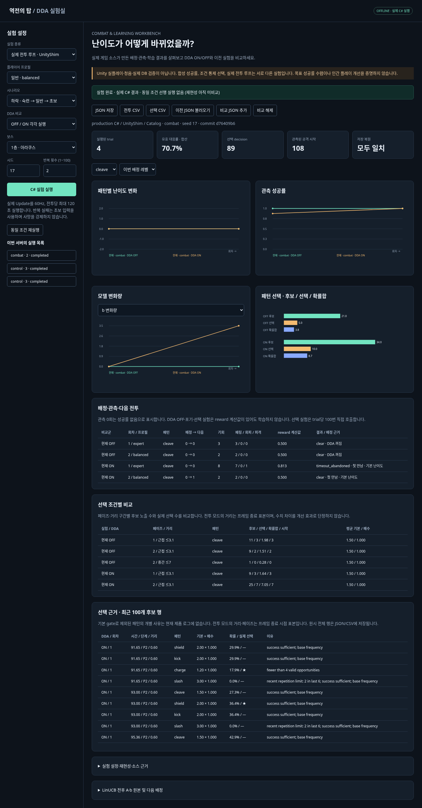

# 역전의 탑 — 안전 통합·회귀검증 후보 (2026-11-18 KST)

## 1. 통합 브랜치와 기준

- 원격 main: `83d9085fb44a6218e721b68b16d620c4669f5d95`.
- PR #50 Git ref/브랜치 head: `be57b0b0173d72dcd8fc205f9e564d06b48f5377` (`feat/tutorial-save-ultimate-integrated-20261117`). Git `refs/pull/50/head`와 일치.
- DDA Lab: `779352c3b38d33790f35873fc270d5e47924e952` (`feat/dda-lab-diagnostics-20261117`).
- 두 대상의 main merge-base는 모두 `83d9085`. main의 별도 통합/병합 완료를 가정하지 않았다.
- 새 브랜치: `integration/dda-lab-tutorial-qa-20261118`, worktree `/workspace/integration-qa`.
- A를 `d4ee1e2`로 no-ff merge, B를 `bad191d`로 no-ff merge했다. 두 원본 head가 후보의 조상임을 확인했다.
- 기존 work/검증/DDA Lab worktree의 미커밋·미추적 파일을 확인했고 변경하지 않았다. 원본 브랜치·main에 push/force-push/병합하지 않았다.
- PR #50 API 조회는 Forbidden. Draft/미병합 상태는 사용자 제공 정보이며, 이번에 검증한 것은 정확한 Git head/전체 diff와 문서/소스/실행 결과다.

## 2. 충돌과 해결

실제 텍스트 충돌은 **CloudSync.Awake 한 곳**이었다.

| 항목 | 보존/해결 |
|---|---|
| PR #50 프로필 UUID | `SaveStore.Load().cloudPlayerId` 유지. Lab의 옛 PlayerPrefs UUID 생성 경로를 되살리지 않음 |
| Lab 수신 진단 | 설정 없음/자동검증 상태 계측, 수신 상태·revision·배정 스냅샷·F8 캐시 갱신 유지 |
| 큐 소유권 | Pending의 캡처된 owner, 실제 ResolveUploadOwner, owner별 등록, 잘못된 파일 보존 모두 유지 |
| GameServices 자동 병합 | Lab 진단/미리보기 stamp와 PR #50의 30개 이후 history 무삭제 동작 모두 보존 |
| 실행기 기능 충돌 | 새 TutorialAssessment/부분 클래스 의존성 추가, Lab의 격리 실험 fixture만 온보딩 완료로 설정 |

파일 전체를 한쪽 것으로 덮어쓰지 않았다. GameData/SaveStore/TowerGame.Tutorial/TutorialSession/BossPatternSystem/WorldArtist/NativeGameUI/ScenePresentation/ArakusEchoView는 PR #50 원본과 바이트 동일하다.
DdaPanel은 DDA Lab 원본과 바이트 동일하다. RewardLedger의 무삭제 history 구현도 PR #50과 동일하다.

## 3. 이번 최소 수정

### 제품 코드 (원본 두 브랜치에는 미반영)

- **CloudSync.cs**: 거부된 owner를 별도 flag로 유지. 잘못된 큐 뒤 정상 POST가 성공해도 전체 상태를 성공으로 덮지 않는다. in-flight 중 추가돼 다음 SyncAll을 기다리는 큐 개수도 표시한다. 전송 순서/재시도 트리거/DB 스키마 변경 없음.
- **TowerGame.cs**: Update 시작 시 튜토리얼 여부를 캡처. 완료 저장 재시도/나가기에 사용한 Enter/Escape가 같은 프레임에 다음 화면의 시작/닫기 입력으로 재사용되지 않도록 한다. 게임의 공격/판정/수치 변경 없음.
- CloudSync의 충돌 해결 외 제품 변경은 위 두 건뿐이다. 기존 DDA 난이도 정책을 변경하지 않았다.

### 테스트·실행기

- `Tools/DdaLab/lab.py`, `Experiment.cs`: 실제 tutorial source를 컴파일 목록에 포함. 실험 fixture에 `tutorialOnboardingVersion=1`; 제품 온보딩을 무력화하는 코드가 아님.
- `run-dda-system-audit.py`, `DdaSelectionAuditTests.cs`: 새 의존성/fixture 호환.
- `run-cold-start-integration.py`, `CloudSyncStatus/Stubs.cs`: 실제 TutorialSession/SaveStore까지 컴파일. ownership을 임의로 PASS시키는 fake resolver는 만들지 않았다. 좁은 옛 status 테스트에서 owner 관련 stub 호출은 NotSupportedException이다.
- `CloudSyncStatus/Program.cs`: 비어 있는 큐에서 등록 POST를 한다는 과거 가정을 수정. 새 구현은 owner가 있는 항목만 등록하므로, GET 실패와 전송 실패를 혼동하지 않는 단언으로 유지했다.
- `TutorialDdaIntegrationTests.cs`, `CloudQueueIntegrationTests.cs`, `run-integration-qa.py`: 실제 세션/강화 검 충돌/저장/리셋/복원/업로드 코루틴 교차 검사.
- `Contracts/TutorialAssessmentLabAdapter.cs`: 실제 group `normal`→실험 agent `balanced`의 **테스트 전용 명시적 이름 매핑**. runtime 난이도/DB 연결 아님.
- 과거 `TutorialAssessmentCandidate`는 삭제하지 않고 superseded proposal임을 표시했다. 실제 TutorialAssessment로 오인하지 않는다.
- `scope_contract.py`, `test-scope-contract.py`, 두 아트 검사/통합 실행기: 아래의 명시적 기준·정확 해시 보호를 추가했다.

코드 보존 검사 16개 모두 참이다. BanditModel 전체, DdaPatternFrequency, Decide, Complete, SelectPattern이 main과 바이트 동일하다. 자연 전투 결과는 승인된 PR #50 궁극기 변경 때문에 기존 main과 달라질 수 있으며 이를 새 DDA 정책의 효과라고 해석하지 않는다.

## 4. 실제 실행 결과와 FAIL 분류

환경: Linux x64 / .NET 8.0.428 / HEADLESS UnityShim 또는 명시적 Unity·HTTP double / Python / Chromium headless.
실제 Supabase, 인증정보, 개인 저장 파일, 기존 CloudQueue를 사용하지 않았다. 모든 쓰기/실패 주입은 생성한 격리 폴더에서만 수행했다.

| 검사 | 실제 결과 |
|---|---|
| 변경 없는 main Headless | **738 PASS**. 요청에 언급된 float 정확 비교 실패는 이 환경에서 재현되지 않음 |
| 병합 직후 후보 Headless / 궁극기 | **738 PASS / 37 PASS**. Q/W/E 한번 15, R 시전 감소·강화·메아리·계승·양방향/거리/시간 등 |
| 기존 프로필 아카이브 | **31 PASS / 0 FAIL**. 초기화·복원·UUID·원본 보존·35/2000 summary·저장 실패 |
| 최종 통합 (검토 scope contract 사용) | **9/9 suite PASS** |
| 통합 내부 | Headless738, DDA269, 이력47, 패널 계산205, charge325, animation430, size953, room207, sprite87, Charge PNG 5프레임 |
| 기존 DDA 감사 | 학습269×2, 실제 Update 전투240×2, selector2,968결정×2. 결과 **64/64 동일**, Catalog/에셋 숫자 패턴 차이0 |
| 빈도 / robustness / 기존 모의 수신 | **185 / 31 / 16 PASS** |
| 실제 CloudSync→CommunityStats→Prepare | **23 PASS**. 모의 HTTP 중단/재개/취소·실패·잘못된 행·개인 우선·F8 stamp |
| 튜토리얼 순수 이벤트 상태 | **30 PASS**. 단계, 스킵, 반복, 최초/재평가, 실제 관측 수와 잠정 분류 |
| 튜토리얼 저장 실패/재시도/취소 | **7 PASS** |
| 실제 튜토리얼+궁극기+저장+DDA 교차 | **24 PASS** |
| 실제 큐+프로필 리셋/복원+모의 HTTP | **24 PASS**. 마지막 3개 확장은 해당 suite만 다시 실행 |
| DDA Lab 통합 | **46 PASS**, 실제 C# 3모드/5보스/3프로필/상승·하락/시드·저장·재현성 |
| Chromium UI | C# 실행/재실행/그래프·JSON/CSV 데이터/다운로드/비교 불러오기/잘못된 입력/좁은 화면·실제 전투 모드 확인, JS 오류 없음 |
| scope guard 자체 | 임시 Git 저장소의 1 test, 여러 단언 PASS. 승인 변경 commit 후 유지, 미승인 변경을 commit해도 실패, 새 미추적 source 실패, mutable baseline 거부 |

중복되는 검사 수를 합산해 독립 검증 건수로 표시하지 않는다. 읽기/단순 정적 검사와 실제 C# 실행, 모의 HTTP, Unity 실플레이는 다른 범위다.

### 재현/해결한 실패

| 초기 FAIL/관측 | 분류 | 조치/최종 |
|---|---|---|
| Lab/Cold Start `TutorialAssessment` 의존성 누락 | **신규 통합 실행기 호환 문제** | 실제 타입/부분 클래스 추가, 온보딩 완료 fixture 명시. Lab46/Cold23 PASS |
| 이전 2개 `*_source_unchanged` | **낡은 검사 가정/검사 범위** | 아래 참조. 삭제/무조건 PASS하지 않음 |
| `battle_result_only_gate` | **낡은 검사 가정** | PR #50의 TutorialRoom ternary를 인식하지 못함. Battle/Result gate와 tutorial/non-tutorial 분기를 정확한 문자열로 검사 |
| 잘못된 owner 뒤 정상 POST가 성공하면 상태가 “동기화됨” | **대상 A의 기존 기능 결함, 교차 검사에서 발견** | 실패 상태 보존. 큐의 실제 payload/소유권은 바꾸지 않음. 새 검사 PASS |
| 튜토리얼 저장 재시도 Enter가 보스전 시작에도 사용됨 | **대상 A의 기존 입력 결함, 교차 검사에서 발견** | 프레임의 tutorial 입력 재사용 차단. 실제 Update 검사 PASS |
| 희소 구버전 JSON의 필드 누락 오류 | **테스트 더블 제약** | 기존 DataContractJsonSerializer가 모든 현 필드를 요구. 실제 SaveStore+필드 허용 System.Text.Json 하네스로 동일 migration 단언 이동. 제품 serializer를 바꾸지 않음 |
| PR #50에서 언급한 float 정확 비교 | **현재 미재현** | main/후보에서 `Old permanent stats still contribute` 포함 통과. 기대값·오차 기준을 낮추지 않음. 다른 Unity/Mono 환경은 미검증 |

### 이전 두 scope FAIL을 정확히 해석하는 방법

`combat_DDA_DB_input_camera_scene_prefab_settings_unchanged`와 `DDA_DB_save_player_rules_source_unchanged`는 고정된 옛 승인 baseline이 아니라 **git diff HEAD**를 검사하고 있었다.
이전 Lab의 미커밋 진단 변경을 탐지했으나, 같은 코드를 commit하면 자동으로 통과하므로 이것만으로 main 대비 안전성을 입증하지 못한다.
이번 병합 직후 clean HEAD에서는 이 두 개는 통과했고, 실제 남은 room FAIL은 새 tutorial-room 문자열 가정이었다.

이번에는 `--scope-contract Tests/Contracts/INTEGRATION_SCOPE_20261118.json`을 제공한다.
계약은 main의 전체 SHA `83d9085...`, 정확한 입력 두 SHA, 검토한 변경 파일 18개의 SHA-256와 사유를 고정한다.
지정 범위의 변경은 해당 해시와 정확히 일치할 때만 허용하며, 새 partial까지 포함해 모든 runtime scripts를 보호한다. 미승인 변경/새 파일은 commit 여부와 무관하게 실패한다.
기존 자원·피벗·PNG·배치·원본 픽셀 검사는 유지했다. default HEAD 모드는 옛 단일 아트 작업용으로 남겼으나 **통합 검증에는 반드시 명시적 계약을 사용**한다.
통합 run 이후 전체 runtime partial 보호를 한 줄 더 강화했고 해당 room suite를 단독 재실행해 207/0을 확인했다.

## 5. 통합 완료 / 코드만 구현 / 미검증

- **자동검증으로 통합 확인**: 실제 tutorial session과 실제 R/J 충돌 완료, 평가 저장·재평가·실패 복구, DDA 제외, profile reset/restore와 큐 owner, Cold Start 수신/Prepare, Lab 실행·재현성.
- **코드가 후보에 있으나 실제 화면 미검증**: tutorial Game View 조작·HUD spotlight, native UI 설정/프로필 메뉴, ArakusEchoView, F8/F9 글꼴·클리핑·스크롤·입력 소비·CSV와 화면 대조.
- **현재 미실행**: Unity API 컴파일·Unity scheduler·Game View·실제 mixer/DSP·청음·Windows 빌드/플레이·실제 네트워크.
- `/opt`, PATH와 workspace의 실행 파일 검사에서 사용 가능한 Unity 6000.4.0f1을 찾지 못했다. 설치/라이선스가 있다고 추정하지 않았고, HEADLESS PASS를 Unity PASS로 표시하지 않았다.
- PR #50의 기존 `UnityTutorialBatchProbe.cs`는 후보에 그대로 보존했다. 이번 환경에서 실행하지 않았다.

## 6. 실제 튜토리얼 평가와 DDA 연결 상태

실제 `TutorialAssessment`: schemaVersion, group(novice/normal/expert), score/confidence, parry/dodge attempts/successes, damageHits/retryCount/activeDurationSeconds, completed/skipped/valid/isFirstAssessment, task measurements, 궁극기 실행 여부 등이다.

- 실제 완료 결과가 disk reload에서 보존됨. 원본 최초 평가를 성공한 재평가·재평가 스킵·중단이 덮어쓰지 않음.
- 처음 스킵은 onboarding 완료 상태로 저장하되 `skipped=true/completed=false/valid=false`; 실제 숙련도 증거로 사용하지 않음.
- 신규 reset은 새로운 UUID와 평가 없는 onboarding으로 시작. 복원은 해당 checkpoint의 UUID·최초 평가·별도 재평가를 보존.
- 실제 tutorial에서는 DDA Prepare/Complete·보상·일반 BattleLogged/DB 큐 이벤트를 발생시키지 않음. 비교용 원본 A/b·기억·진행도를 보존하는 교차 검사 수행.
- 스코어와 confidence는 PR #50의 잠정 규칙을 유지했다. 과학적 숙련도 추정/확률로 검증한 것은 아님.
- 테스트 전용 adapter는 `normal`→`balanced`를 명시적으로 매핑하고 `balanced`를 제품 group으로 조용히 허용하지 않음. 건너뜀/미완료/invalid 데이터는 거절.
- 같은 save에서 tutorial group만 바꿔도 실제 Prepare 레벨이 바뀌지 않는 것을 확인. 숙련도별 DB 집계·초기 난이도 보정·지속 보정·새 SaveData 필드는 구현하지 않음.
- first battle 강제 대기·영속 통계 캐시·주기 retry도 추가하지 않음. 기존 개인 기억/공동 표본/fallback 정책을 유지.

## 7. 집 PC의 Unity 직접 확인

1. 후보를 **독립 테스트 복사본**에 준비. 실제 `supabase.json`은 복사/열람하지 말고 제외. 개인 save/CloudQueue를 지우거나 옮기지 말 것.
2. 테스트 전용 OS 계정 또는 독립 복사본의 별도 Company/Product 저장 경로로 개인 persistentDataPath/PlayerPrefs와 분리한 후 Unity 6000.4.0f1·라이선스·필수 빌드 모듈 확인.
3. 실제 API 컴파일, TowerProduction Game View에서 첫 진입/읽기 중 정지, Q/W/E/이동/점프/공격/대시/회복약, 파란 패링/빨간 회피/실패 재시도, R 후 실제 검 명중 완료를 확인.
4. 완료/저장 실패 시 Enter 재시도·Escape 나가기·재평가 성공/스킵·중단. 첫 평가 유지, 새 프로필 reset/restore, snapshot 이후 기록 보존과 UI 메시지 확인.
5. Q/W/E 1회 15, R 초기 무적/시전 감소/8초 검 강화 구분, 아라쿠스 저/고 메아리 양방향·판정·종료·계승을 실플레이. 수치를 임의로 바꾸지 않음.
6. F8/F9 현재 배정·개인 학습·다음 배정·배정 당시 근거/현재 수신 표시, 스크롤/리사이즈/화면 잘림·전투 입력 소비·CSV를 대조. 실제 DB 수신은 하지 않고 mock 경계 검사를 사용.
7. 보스별/로비 BGM·phase 전환·ESC/설정 pause/resume·복귀·누락 fallback을 청음. 이번에는 음원 생성/교체나 품질 판정을 하지 않음.
8. 분리된 출력/저장 경로로 Windows 빌드·실행·직접 조작 확인. `-tower...` 자동검증은 F8/수동 입력을 억제하므로 실제 GUI QA 대용으로 쓰지 말 것.
9. 원한다면 PR #50 batch probe를 **테스트 복사본에만** 넣어 batch/null graphics/isolated data 조건으로 실행. 이는 OS 키 입력·실제 UI 픽셀·청음 증거와 별개.

## 8. 재실행 및 전달

```bash
# 저장소 루트, .NET 8 SDK 필요
python Tests/run-integration-qa.py --dotnet dotnet --output <새-cross-output>
python Tests/run-final-integration.py --dotnet dotnet --output <새-full-output> --scope-contract Tests/Contracts/INTEGRATION_SCOPE_20261118.json
python Tests/run-dda-system-audit.py --dotnet dotnet --output <새-audit-output>
python Tests/run-dda-history.py --suite profiles --dotnet dotnet
python Tests/run-ultimate.py --dotnet dotnet --output <ultimate-output>
python Tests/run-cold-start-integration.py --dotnet dotnet
python Tests/test-dda-lab.py --dotnet dotnet
python Tools/DdaLab/lab.py --data-dir ./TestResults/DdaLab
```

현재 Cloud SDK 경로는 `/workspace/.cloud-setup/dotnet/dotnet`. named mutex 샌드박스 제한 때문에 지원되는 command escalation을 사용했다. TLS/서명/검사를 비활성화하지 않았다.
상세 근거: [결과 JSON](INTEGRATION_QA_20261118_RESULTS.json), 현재 환경 `/workspace/integration-results`의 초기/최종 log/manifest/CSV.
대용량 원시 CSV는 commit하지 않았다. 새 결과 폴더 강제·실제 exit code·소스 해시·실행 중 소스 안정성으로 이전 산출물을 새 실행으로 오인하지 않는다.



커밋: `bad191d` 병합 / `3d7cc33` 실행기 호환 / `61a005f` 최소 제품 수정+교차 검사 / `d76409b`, `f5a01df` scope 보호 / `b2f256e` 실제 reset/restore in-flight 확대 검사.
통합 브랜치만 Push하며 Draft PR만 시도한다. main과 원본 두 브랜치에는 쓰지 않는다.

## 9. 팀원·후속 병합 충돌

특히 CloudSync, GameServices, TowerGame, GameData, SaveStore, tutorial 부분 클래스 및 테스트 목록을 다시 확인해야 한다.
PR #50/Lab 원본 commit을 조상으로 유지해 중복 cherry-pick하지 않아도 되도록 했다. 다만 이후 팀원 수정은 이 후보가 자동으로 포함하지 않는다.
원본 PR 하나가 먼저 main에 들어가거나 수정되면 origin/main 및 두 head를 다시 확인하고 이 후보에 merge하여 의미 충돌/테스트를 재검증한다.
scope 계약은 자동 재승인하지 말고 변경 근거를 리뷰한 뒤 정확한 hash만 갱신한다. 씬·Prefab·아트·DB 스키마 변경은 이번 호환 수정에 추가하지 않았다.

## 10. 11/20 기능 동결·11/23 발표 전 남은 문제

**동결 전 필수**: Unity 컴파일/실제 튜토리얼·F8 조작/궁극기 시각·판정/Windows·청음 확인, 본 후보의 작은 제품 수정 2건과 scope 계약 리뷰, GitHub 필수 체크/리뷰 확인, 튜토리얼 score/confidence의 잠정 성격과 첫 판 fallback 표현 합의.
이번 자동검증 범위에서는 미해결 신규 FAIL이 없다. 실제 Unity QA를 하지 않은 상태로 발표/배포 검증 완료를 선언하지 않는다.

**기획 합의 보류**: 숙련도별 Supabase 집계·새 난이도 정책/스키마, first-Prepare 강제 대기, TTL/영속 캐시/주기 retry, archive 정리 정책. 임의 구현하지 않았다.
새 카드가 sync 도중 enqueue되면 기존 규칙대로 다음 trigger까지 보관된다. 대기 수를 표시하지만 주기 자동 retry를 새로 추가하지 않았다.
프로필 아카이브/전체 history는 삭제하지 않아 성장한다. 2000요약 검사는 무한 저장·디스크 고갈 안전성 증명이 아니다. 다중 게임 프로세스 저장 잠금도 범위 밖이다.

현재 후보는 **자동검증을 통과한 통합 검토 후보**이며 main 병합·환경 게시·운영 DB 변경·출시 배포는 수행하지 않았다.
