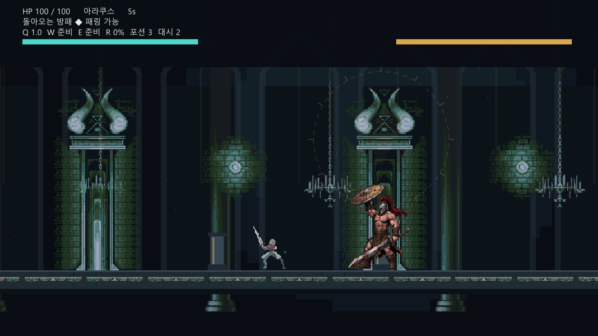
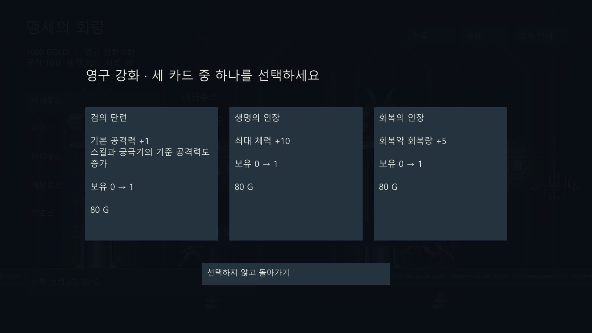

# 역전의 탑 0.5 — 아라쿠스 제작 기반

Unity **6000.4.0f1**. 팀 공통 개발 기준은 이 저장소의 최신 **main**입니다. 기존 0.4 기반에 제작 구조·아라쿠스 패턴·패링 신호·새 주인공·전투 연출·DB 연동 코드를 통합했습니다. 기존 팀 저장소는 참고용이며 변경하지 않습니다.

먼저 [팀 협업 안내](CONTRIBUTING.md)를 읽고 최신 main에서 작업별 브랜치를 만드세요. 현재는 통합 개발본이며 정상 플레이 완주·밸런스·실제 DB 연동의 최종 검증은 남아 있습니다. 실제 DB 설정이 포함돼 있어 일반 실행 시 통신을 시도할 수 있습니다.

실행 씬: `Assets/Scenes/TowerProduction.unity`. 플레이어/아라쿠스 Prefab·Animator, 팀 제공 아라쿠스 시트, 보스5종 ScriptableObject, 핵심 화면 uGUI가 연결되어 있습니다. 신규 보스 패턴을 모두 구현한 버전은 아닙니다.

- [진단](Docs/M0/01_Diagnosis.md)
- [보스 기획 현황·충돌](Docs/M0/02_BossSpecMatrix.md)
- [구조·로드맵](Docs/M0/03_ArchitectureRoadmap.md)
- [자료 요청](Docs/M0/04_AssetRequest.md)
- [검증과 미완료](Docs/VALIDATION.md)
- [아트 출처](Docs/Art/TEAM_ASSETS.md)

로컬 검사: `Verify-Logic.ps1`. Unity 배치빌드 진입점: `FoundationSetup.Build`.
로비 → 세 카드 중 한 장 영구 강화 또는 건너뛰기 → 보스전 → 정산 → 로비 흐름을 유지합니다.

실제 0.5 Windows 캡처(디자인 최종 승인 전):

## 아래는 0.4/0.3의 이전 이력

현재 버전은 상위 폴더의 `먼저읽기.md`, `변경보고서.md`를 기준으로 한다. 로직 검사 114개, 실제 Unity 6000.4.0f1 Windows 빌드, 플레이어 로비 통합검사 14개를 확인했다. 이번 아트 교체는 하지 않았다. 아래 내용은 수정 전 0.3의 이력이며 현재 버전의 실행 실패를 뜻하지 않는다.

## 이전 버전 이력: 리소스 교체판 0.3

**현재 상태: 최종 Windows 실행 검증 대기.** 리소스 선정·연결 코드 작성과 컴파일은 완료했습니다. 관리형 미디어 재생을 사용하는 중간 버전은 실행·리소스 해석 검사가 통과했지만, 최종 검사 코드를 추가해 다시 만든 실행 파일은 Windows 애플리케이션 제어 정책에 차단되었습니다. 이 압축파일의 실행 후보가 정상 실행된다고 검증한 상태는 아닙니다. 보안 정책을 변경하거나 우회하지 않았습니다. 기존 0.2 체험판 압축파일은 별도로 보존했습니다.

0.3에서는 LuizMelo의 Hero Knight 연속 모션, Jetrel의 성 배경·타일, StarNinjas의 검·충돌 효과음, Emma_MA의 보스전 음악을 직접 선정해 연결했습니다. 각 제작자 페이지에 CC0로 명시된 리소스를 사용하며 출처와 처리 내역은 `Assets/StreamingAssets/CREDITS.md`에 기록했습니다. 보스 캐릭터는 이전 도트 초안을 유지합니다. 전용 패링·회복약·대시 모션은 해당 팩에 없어서 다른 포즈와 이펙트를 조합했습니다.

0.2에서 캐릭터를 48×48 픽셀 격자에서 그린 스프라이트로 교체했습니다. 대기·이동·공격·패링 자세를 구분하고, 배경을 포함한 게임 화면은 저해상도로 그린 뒤 확대합니다. Windows 프리뷰는 기본 창 크기 1600×900에서 400×225 화면을 4배 확대합니다. UI와 글자는 원래 해상도로 표시합니다. 전투·성장·DDA 규칙은 유지했습니다. 0.1 압축파일은 이전 버전으로 별도 보존했습니다.

팀 레드불의 기획 자료를 바탕으로 기존 팀 프로젝트와 별도로 새로 작성한 게임입니다. 코드·진행·화면이 있는 첫 프로토타입이며, 최종 아트나 밸런스가 확정된 완성판은 아닙니다.

## 먼저 체험하기

프로젝트 옆 `WindowsPreview` 폴더의 `ReversalTowerPreview.exe`를 실행하세요. 압축파일로 받았다면 폴더 전체를 먼저 풀어 주세요. Windows의 .NET Framework 4.x를 사용하며, Unity 설치 없이 실행하는 별도의 데스크톱 프리뷰입니다.

프리뷰는 이 프로젝트의 **동일한 전투·보스·DDA·UI·저장 소스**를 사용합니다. 화면 표시와 입력 연결에 작은 Windows 어댑터를 사용하므로 Unity 실행 파일은 아닙니다. 그래픽은 실제 프리뷰 화면을 확인했으며, Unity 편집기의 그래픽·오디오 동작은 별도 검증이 필요합니다. 0.3부터 프리뷰에도 실제 검 효과음과 보스전 음악이 들어 있습니다. 실행 파일 옆 `Assets` 폴더를 함께 유지하세요.

## 조작

| 입력 | 행동 |
|---|---|
| A / D 또는 좌우 방향키 | 이동 |
| Space | 점프 |
| J / Z / 마우스 왼쪽 | 검 2타 콤보 |
| K / X / 마우스 오른쪽 | 패링 |
| Shift | 대시, 2스택 |
| Q / W / E | 돌진 베기 / 회전 베기 / 처형 베기 |
| R | 장착 궁극기 |
| F | 회복약 |
| Escape | 일시정지 또는 위쪽 창 닫기 |
| F1 | 조작 안내 |

첫 전투에는 조작 안내가 표시됩니다. 보스가 파랗게 빛나는 공격과 파란 예고는 패링 가능, 붉은 신호는 회피·이동이 필요하다는 뜻입니다. 받아칠 순간 직전에는 푸른 별빛이 번쩍입니다. 궁극기는 패링 성공 +15, 누적 피해, 전투 30초 이후 자연 충전으로 준비합니다. 회복약은 전투당 3개이며 40 체력을 회복합니다.

## 현재 들어 있는 게임

- 타이틀 → 로비 → 보스전 → 결과 → 성장 → 재도전의 진행.
- 아라쿠스, 파네스, 아디쿠스, 에텔로스, 카로스의 32개 패턴 정의.
- 아라쿠스의 기둥 충돌, 파네스의 투사체 반사·결계, 아디쿠스의 소환수·저울, 에텔로스의 번개, 카로스의 잔상·회피 봉인.
- 체력 60%에서 페이즈 전환. 카로스는 30%에서 추가 전환.
- 보스 첫 처치 시 고유 궁극기를 획득하고 자동 장착. 로비에서 변경 가능.
- Gold로 공격력·최대 체력 강화, 각각 10단계.
- 에텔로스 처치 후 일반 엔딩과 심연 개방. 카로스 처치 후 추가 엔딩.
- 최근 30회 전투 기록, 저장 백업, 전투별 CSV.
- 보스·패턴별 LinUCB 기반 적응 난이도와 고정 난이도 선택.
- 공개 CC0 주인공 애니메이션·성 배경·검 효과음·보스전 음악. 도트 보스와 일부 합성 효과음은 기존 초안 유지.

## 제 버전에서 선택한 방향

기획의 패링·계승·패턴 단위 DDA를 중심에 놓았습니다. 그래픽은 청록색 플레이어와 금빛 보스가 어두운 탑에서 대비되는 형태로 시작했고, 0.2에서 도트 스타일로 변경했습니다. 참고 GIF의 모션을 그대로 복제하지 않았습니다.

보스별 세부 패턴은 첫 프로토타입에 맞게 단순화·재구성했습니다. 예를 들어 원본의 복잡한 카로스 환영 기믹은 지연 공격과 회피 봉인으로, 아디쿠스의 저울은 소환수 수에 따른 안전 구역으로 구현했습니다. 원본의 모든 보스 기획을 세부 수치까지 구현한 버전이라는 뜻은 아닙니다.

처치 전에도 기본 궁극기 `반역의 불꽃`을 사용합니다. 기획서의 미정 항목은 이 버전의 선택으로 채웠습니다. 공격 모션의 판정 이후 대시 취소를 허용하고, 스킬 중 패링은 제한했습니다. 실패 보상은 보스에게 준 피해에 비례하며 즉시 중단으로 Gold를 얻을 수 없습니다.

## DDA

보스마다 5개 팔과 6개 문맥 특징을 가진 disjoint LinUCB 모델을 저장합니다. 문맥에는 해당 패턴의 대응 성공률, 전체 성공률, 현재 보정 단계, 영구 강화 수준, 연패 횟수가 들어갑니다.

- 보정은 -2~+2이며 전투 사이 한 단계씩만 이동합니다.
- 선딜 배율 1.30~0.80, 피해 배율 0.80~1.20, 쿨타임 배율 1.25~0.80을 사용합니다.
- 첫 전투는 기본값, 초반에는 과도한 실패·성공에 대한 사전 규칙을 사용합니다.
- 3연패 이후에는 한 단계 쉬운 쪽을 선택합니다.
- 한 방 피해는 최대 체력의 30% 이하이며 패링 판정 시간은 고정입니다.
- 설정 변경은 다음 전투에 반영됩니다. 현재 전투는 시작 시 DDA 설정을 고정합니다.
- 고정 난이도 전투는 기록을 남기되 학습 모델을 변경하지 않습니다.

현재 모델은 작동 구조를 검증한 단계입니다. 실제 사람에게 난이도 개선 효과가 있다는 결론이나 기획서의 연구 결과를 재현했다는 의미는 아닙니다.

## Unity에서 열기

1. Unity Hub에서 **Add project from disk**로 이 폴더를 추가합니다.
2. 기준 버전은 **Unity 6000.4.0f1**입니다. Windows Build Support가 필요합니다.
3. 처음 가져오기가 끝나면 `Assets/Scenes/Tower.unity`를 열고 Play를 누릅니다.
4. 또는 상단 메뉴 **Reversal Tower → Open Game**을 선택합니다.
5. Windows 빌드는 **Reversal Tower → Build Windows** 또는 `Build-Windows.cmd`를 사용합니다.

빌드는 프로젝트 옆 `Windows/ReversalTower.exe`에 생성됩니다. Unity 편집기로 이미 이 프로젝트를 열어 놓았다면 메뉴를 사용하세요. 동시에 같은 프로젝트를 다른 편집기 프로세스에서 열 수 없습니다.

외부 패키지를 내려받지 않도록 설치된 Unity의 기본 모듈만 사용합니다. 현재 환경에서는 Unity 캐시 폴더 쓰기 권한이 없어 편집기 시작 단계에서 중단되어, 실제 Unity 빌드와 실행은 검증하지 못했습니다. Unity의 실제 모듈 DLL을 참조한 C# 컴파일 검사는 통과했습니다.

## 저장 위치

- Windows 프리뷰: 실행 파일 옆 `UserData`.
- Unity 게임: Windows의 `AppData/LocalLow/IndependentTower/Reversal Tower`.
- `progress.json`은 진행, `progress.json.bak`은 이전 저장본, `Battles`는 전투 CSV입니다.
- 두 버전은 저장 폴더를 분리하며 저장파일의 상호 호환을 보장하지 않습니다.
- 계정, 온라인 전송, 클라우드 저장은 없습니다.

## 리소스 교체 위치

Unity 원본은 `Assets/StreamingAssets`, Windows 프리뷰는 실행 파일 옆 `Assets`에서 리소스를 읽습니다. `Art/Hero`는 주인공 PNG 시트, `Art/Castle`은 배경, `Audio`는 WAV 음원입니다. 현재 주인공 시트는 180×180 셀을 가로로 배열한 Hero Knight 형식을 사용합니다. 같은 형식·파일명으로 바꾸면 다음 실행에서 반영되고, 다른 형식은 ExternalAssets.cs의 프레임 규격·정렬을 맞춰야 합니다. 임의의 시트를 자동 인식하는 기능은 아닙니다.

음원은 현재 PCM 16비트 WAV를 지원합니다. 데스크톱 프리뷰는 22050Hz 모노 파일을 사용합니다. `attack.wav`, `parry.wav`, `hit.wav`, `dash.wav`, `battle.wav`를 해당 이벤트에 연결했습니다. 교체 전에 원본을 별도로 보관하고 새 자료의 이용 조건을 확인하세요.

## 검증

`Verify-Logic.ps1`은 Unity를 실행하지 않고 실제 전투 코드를 테스트용 어댑터와 함께 컴파일해 실행합니다. 보스 정의, 패링, 무적, 대시, 회복약, 반사, 기둥 충돌, 저울, 궁극기·해금, DDA 설정 고정, 원자적 저장·백업 복구, 5종 보스의 최대 180초 진행을 검사합니다.

이 검사는 Unity 그래픽·오디오·최종 프레임레이트 검증을 대신하지 않습니다. `Preview/`는 데스크톱 프리뷰 어댑터이고 `Tests/UnityShim.cs`는 그 어댑터 및 로직 검사용 기반입니다. 둘 다 `Assets` 밖에 있어 Unity 게임에는 포함되지 않습니다.

프리뷰를 다시 만들려면 `Build-Preview.ps1`을 실행합니다. 제작에는 설치된 Unity의 Roslyn 컴파일러를 사용하며, 결과 프리뷰 실행에는 Unity가 필요하지 않습니다.

## 남은 작업

실제 Unity 편집기·Windows 플레이어 실행, 사람의 플레이테스트, 패턴 예고와 조작감 조정, 정식 스프라이트·애니메이션·음악 제작, DDA 실험이 남아 있습니다. 현재 자동 검사나 프리뷰 실행이 모든 보스의 재미·공정성·클리어 가능성을 보장하지 않습니다.
